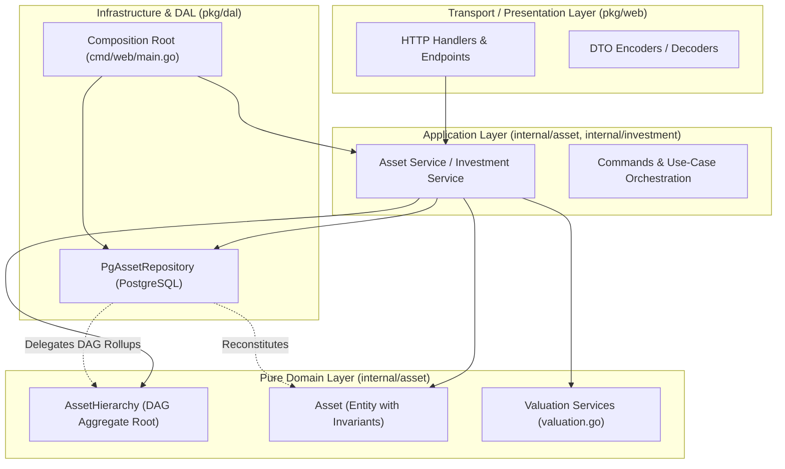

# Asset-Centric Resource Model & Asset Composition

## 1. Overview & Conceptual Architecture

**Projecta** uses an **Asset-Centric Resource Investment Model**. Rather than treating financial tracking as a flat ledger of uncategorized expenses, value and expenditures are organized around **Assets**—the tangible or intangible deliverables, acquisitions, components, and operational periods of a project.

```
Project (Workspace & Base Currency Context)
  │
  ├── Total Project Invested = ∑ (Direct investments across all project assets)
  │
  └── Assets (Core Units of Value / Acquisition / Ownership)
        │
        ├── Hierarchical Composition: Directed Acyclic Graph (DAG)
        │     ├── Parent-Child links with customizable Share % (e.g., 50%, 100%)
        │     └── Many-to-Many: A child asset can be shared among multiple parents
        │
        ├── Valuation & Cost Aggregation:
        │     ├── Direct Cost = ∑ (Direct investments on this asset)
        │     ├── Rolled-Up Total Cost = Direct Cost + ∑ (Child Asset Total Cost × Share %)
        │     └── Target Budget / Price (in any supported currency)
        │
        └── Investments (Resource Contributions)
              ├── Resource Types: MONEY, TIME, GOODS
              ├── Financial Valuation: Normalized monetary amount
              └── Flexible Tags: (#rent, #labor, #hardware, etc.)
```

---

## 2. Asset Entities & Lifecycle

### Core Attributes
- **Asset ID**: Unique UUID identifier.
- **Project ID**: The project workspace boundary the asset belongs to.
- **Name & Description**: Human-readable title and details.
- **Status**:
  - `ACTIVE`: Ongoing acquisition, operation, or development.
  - `COMPLETED`: Acquisition or operational period finished.
- **Dates**:
  - `start_date`: Beginning of the asset lifecycle or billing period.
  - `completed_date` (optional): Completion timestamp.
- **Target Budget**:
  - `target_price`: Expected budget or target purchase price (in cents).
  - `target_currency`: Target budget currency code (e.g., `EUR`, `USD`, `UAH`).

### Creation Flexibility
Assets can be created:
1. **Standalone**: Direct asset creation with target budget, start date, status, and descriptive tags (no legacy cost type required).
2. **From Investments / Payments**: Bundling existing resource investments directly into a newly created asset with automatic tag and value aggregation.
3. **With Initial Investment**: Creating an asset along with its first initial financial investment in a single transaction.

---

## 3. Hierarchical Asset Composition (DAG)

Complex projects often require grouping granular assets into composite milestones or overarching parent assets (e.g., aggregating monthly utility and rent assets into an aggregate "Housing / Living Expenses" parent asset).

### Parent-Child Relationships
- **Composition Link**: `(parent_asset_id, child_asset_id, share_percentage)`.
- **Share Percentage**: Specifies how much of the child asset's cost is attributed to the parent (defaults to 100%, can be partial, e.g. 50%).
- **Many-to-Many**: A single child asset can contribute to multiple parent assets simultaneously.
- **Grouping**: Users can select multiple existing assets and group them into a newly created parent asset in one step.

### Cycle Prevention (DAG Validation)
To maintain mathematical integrity and prevent infinite recursion during cost calculations:
- Self-referencing links (`parent_id == child_id`) are rejected.
- Before linking a child asset to a parent, all ancestors of the parent are inspected.
- If the candidate child is already an ancestor of the parent, the link is rejected with a validation error (`circular dependency detected`).

---

## 4. Valuation & Cost Rollup Formulas

Each asset maintains two distinct cost metrics:

### 1. Direct Cost
The sum of all resource investments contributed directly to the asset:
$$\text{DirectCost}(A) = \sum_{i \in \text{Investments}(A)} \text{Amount}(i)$$

### 2. Rolled-Up Total Cost
The complete valuation of the asset, including direct investments plus the proportional share of all child sub-assets:
$$\text{TotalCost}(A) = \text{DirectCost}(A) + \sum_{C \in \text{Children}(A)} \left( \text{TotalCost}(C) \times \frac{\text{SharePercentage}(A, C)}{100} \right)$$

Cost rollups are calculated dynamically to reflect updates in child asset costs or allocations immediately.

---

## 5. Target Budgets, Multi-Currency Progress & Overbudgeting

Assets can define an optional target budget (`target_price`) in any currency (`target_currency`).

### Multi-Currency Conversion
When the asset currency or project home currency differs from `target_currency`, the system converts the target price using live rates from the exchange rate provider (National Bank of Ukraine - NBU):
$$\text{TargetPrice}_{\text{home}} = \text{Convert}(\text{target\_price}, \text{target\_currency} \to \text{home\_currency})$$

### Progress Calculation & Uncapped Percentage
Budget progress is calculated using normalized values in the same currency:
$$\text{Progress} = \left( \frac{\text{TotalCost}_{\text{home}}}{\text{TargetPrice}_{\text{home}}} \right) \times 100\%$$

- **Uncapped**: Progress is not artificially clamped to 100%. If spending exceeds the budget, it accurately reflects values like `125%` or `1000%`.
- **Dual Display**: When currencies differ, details show both original target budget and estimated converted value:
  `8,925.00 EUR (≈ 410,550.00 UAH)`.

### Overbudget Visual State
When $\text{Progress} > 100\%$:
- The progress bar color shifts to **Orange** (`bg-orange-500`).
- The budget label dynamically switches to **"Overbudget"** / **"Перевитрата"** in orange (`text-orange-600 dark:text-orange-400`).
- An orange outline badge (`OVERBUDGET` / `ПЕРЕВИТРАТА`) is displayed in the asset details view.

---

## 6. Investments & Resource Tracking

Investments represent tangible resource contributions applied directly or shared across assets.

### Resource Types
1. **`MONEY`**: Direct capital expense or funding (`amount`, `currency`).
2. **`TIME`**: Sweat equity or labor (`time_hours`, `time_hourly_rate`), normalized into a mandatory monetary valuation.
3. **`GOODS`**: Donated or utilized materials, equipment, or parts (`goods_quantity`, `goods_unit`, `goods_item_name`), evaluated with a monetary valuation.

### Flexible Tagging Taxonomy
Rigid and restrictive categories and cost types are replaced with arbitrary, searchable **Tags** (`#rent`, `#materials`, `#labor`, `#down-payment`).

### Project Total Invested Metric
To avoid double-counting composed/child asset values across nested hierarchies:
- **Total Invested** (`Всього інвестовано`) on the project totals overview aggregates the raw direct investments across the project.

---

## 7. Backend Domain-Driven Design (DDD) Architecture

The backend implementation organizes business logic and data access according to Domain-Driven Design principles:



### 1. Pure Domain Layer (`internal/asset/`)
- **`AssetHierarchy` Aggregate Root ([`hierarchy.go`](../internal/asset/hierarchy.go))**:
  - Encapsulates the Directed Acyclic Graph structure of assets and composition edges.
  - Enforces cycle detection invariants (`AddEdge` returns `ErrCircularDependency` if a path already exists from child to parent).
  - Calculates recursive cost rollups with dynamic memoization (`CalculateRollups`).
  - Distributes computed valuations back to entities via `ApplyToAssets`.
  - Determines project root assets (`RootAssets`) for hierarchical tree rendering.
- **`Asset` Entity ([`asset.go`](../internal/asset/asset.go))**:
  - Protects state mutation through explicit invariant methods: `AssignValuation`, `UpdateDetails`, `Complete`, and `Reopen`.
  - Uses `ReconstituteAsset` factory for persistence hydration without triggering validation side-effects.
- **Valuation Services ([`valuation.go`](../internal/asset/valuation.go))**:
  - `CalculateBudgetProgress`: Computes progress percentage, overbudget amount, and UI color styling across currencies via `CurrencyRateProvider`.
  - `CalculateProjectTotals`: Computes project balance and total invested without double-counting composed assets.

### 2. Clean Infrastructure Separation (`pkg/dal/`)
- **`PgAssetRepository` ([`pg_asset_repository.go`](../pkg/dal/pg_asset_repository.go))**:
  - Stripped of financial rollup calculations and in-SQL traversal logic.
  - Loads raw assets and composition edge records from PostgreSQL, then delegates rollup propagation to the pure domain aggregate `AssetHierarchy.ApplyToAssets`.

### 3. Application & Composition Root (`internal/asset/service.go`, `cmd/web/main.go`)
- Application services receive explicit dependencies (`InvestmentSource`, `Repository`, `RateProvider`) directly via constructor injection, eliminating temporal coupling.

### 4. Investment Domain Layer & Decoupling (`internal/investment/`)
- **`Investment` Aggregate Root ([`investment.go`](../internal/investment/investment.go))**:
  - Fully encapsulated aggregate with private state (`id`, `project`, `primaryAssetID`, `primaryAssetName`, `assetAllocations`, `contributor`, `resourceType`, `amount`, `timeHours`, etc.).
  - **Decoupled Asset Reference**: References `primaryAssetID uuid.UUID` and `primaryAssetName string` rather than holding a direct `*asset.Asset` pointer, adhering to the DDD rule of referencing other aggregates by identity only.
  - **Invariant Protection**:
    - `Allocate(allocations []InvestmentAssetLink)`: Enforces that multi-asset allocation shares sum to 100%, validates positive non-zero share values, and prevents duplicate asset assignments.
    - `UpdateDetails(description, date, tags)`: Updates descriptive metadata and sanitizes tags.
    - `UpdateValuation(resType, amount, timeHours, timeHourlyRate, goodsQty, goodsUnit, goodsItemName)`: Validates and recomputes valuations (including time-based resource calculation from hours × hourly rate).
    - `ReconstituteInvestment`: Dedicated persistence factory hydrating entities in a single step without re-triggering business validations.
- **Consumer-Owned Ports**:
  - `investment.Service` defines a narrow `AssetReader` interface (`FindOne(ctx, filter) (*asset.Asset, error)`), eliminating tight coupling to the wide `asset.Repository`.
- **Infrastructure Alignment ([`pg_investment_repository.go`](../pkg/dal/pg_investment_repository.go))**:
  - Employs intermediate `investmentRecord` and `scanInvestmentRecord`, eliminating dummy `asset.NewAsset(...)` stub instantiation during persistence scanning.
  - Loads multi-asset allocations and hydrates `Investment` directly via `ReconstituteInvestment`.

