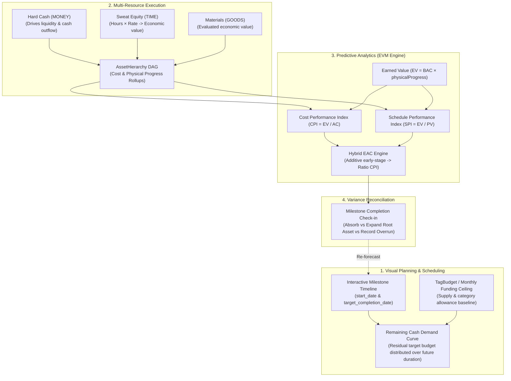
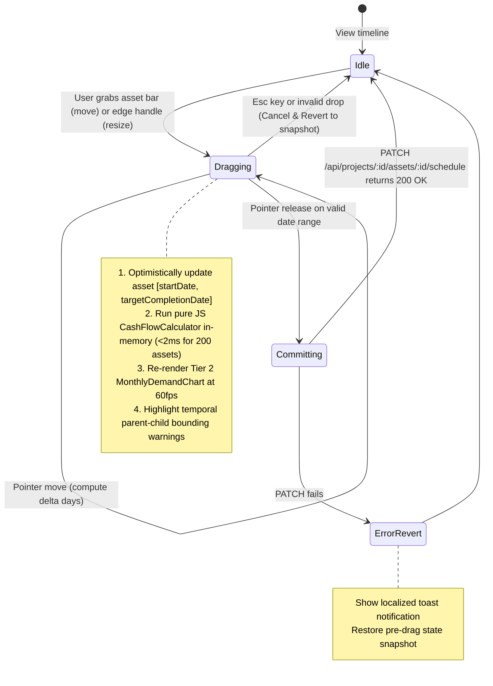
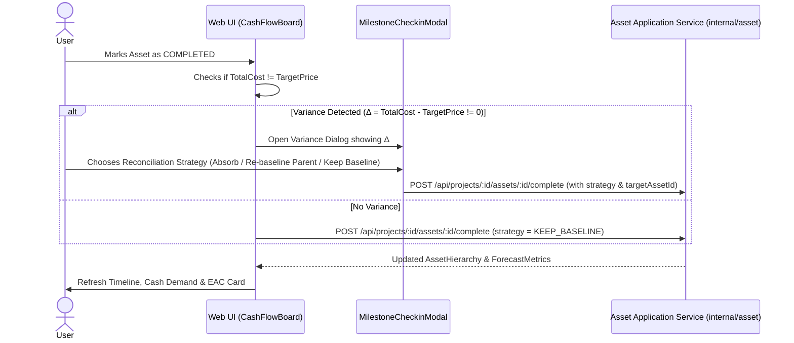

# Capital Investment Planning & Forecasting Specification

## 1. Executive Summary & Architecture Overview

This specification defines the functional, mathematical, and architectural blueprints for **Projecta's Capital Investment Planning & Forecasting Engine**.

Projecta is targeted at **individual investors, home renovators, and venture builders** who need to:
1. **Plan future cash demand visually** across composite asset hierarchies (DAG) without double-counting or losing unallocated parent budgets.
2. **Track execution** across hard currency (`MONEY`), sweat equity (`TIME`: hours × rate), and materials (`GOODS`), distinguishing out-of-pocket bank liquidity from total economic value.
3. **Forecast Estimate at Completion (EAC)** and schedule completion dates using Earned Value Management (EVM) with safeguards for early-stage deposits.



---

## 2. Feature Decomposition & Relationship to Existing `TagBudget`

### 2.1. Module Breakdown

```
┌────────────────────────────────────────────────────────────────────────┐
│               CAPITAL INVESTMENT PLANNING & FORECASTING                │
├────────────────────────────────┬───────────────────────────────────────┤
│ Feature 1: Asset Lifecycle     │ Invariant-protected target dates,     │
│ Dates & DAG Progress Rollup    │ temporal bounding & weighted progress │
├────────────────────────────────┼───────────────────────────────────────┤
│ Feature 2: Remaining Cash Flow │ Residual DAG target distribution,     │
│ Demand & Liquidity Forecasting │ sunk-cost deduction & peak alerts     │
├────────────────────────────────┼───────────────────────────────────────┤
│ Feature 3: Hybrid EVM Engine   │ Mobilization-safe EAC, CPI/SPI, and   │
│ & EV Velocity Completion Date  │ schedule-driven finish date forecast  │
├────────────────────────────────┼───────────────────────────────────────┤
│ Feature 4: Interactive Timeline│ Two-tier visual canvas, 60fps drag    │
│ & Cash Flow Board (UI)         │ rescheduling, and optimistic updates  │
├────────────────────────────────┼───────────────────────────────────────┤
│ Feature 5: Milestone Check-in  │ Post-milestone variance prompts,      │
│ & Variance Reconciliation      │ contingency absorption & re-baselining│
└────────────────────────────────┴───────────────────────────────────────┘
```

### 2.2. Coexistence with `TagBudget` & `ProjectedVsRealSchedule`

Projecta already implements tag-based recurring budget rules via [`TagBudget`](file:///Users/maksym.hryshkov/Code/projecta/internal/project/tag_budget.go#L84-L98) and [`ProjectedVsRealSchedule.jsx`](file:///Users/maksym.hryshkov/Code/projecta/web-ui/src/components/Projects/Charts/ProjectedVsRealSchedule.jsx#L39). The two mechanisms serve complementary roles:

| Dimension | Existing `TagBudget` Schedule (`internal/project`) | New Asset Milestone Timeline (`internal/asset`) |
| :--- | :--- | :--- |
| **Mental Model** | **Category Allowance / Funding Supply** (e.g., *"I can afford $2,000/month on `#materials` and $500/month on `#labor`"*). | **Deliverable Capital Demand** (e.g., *"Roofing runs Aug 1–Aug 20 and requires $8,500"*). |
| **Time Horizon** | Rolling 12-month recurring frequencies (`DAILY`, `WEEKLY`, `MONTHLY`, `ANNUALLY`, `ONCE`). | Explicit asset lifecycle windows (`[start_date, target_completion_date]`). |
| **Integration** | The sum of monthly `MONEY` `TagBudget` projections (or an explicit project monthly limit) serves as the **Monthly Funding Capacity Ceiling ($C_{\text{monthly}}$)** on the Cash Flow Demand chart. | Provides the draggable Gantt bars and demand bars compared against $C_{\text{monthly}}$. |

---

## 3. Feature 1: Asset Lifecycle Dates & DAG Progress Rollup

### 3.1. Domain Model Extensions (`internal/asset/asset.go`)

[`Asset`](file:///Users/maksym.hryshkov/Code/projecta/internal/asset/asset.go#L49-L70) is extended with unexported fields and read-only getters in strict compliance with [`docs/ddd-development-guidelines.md`](file:///Users/maksym.hryshkov/Code/projecta/docs/ddd-development-guidelines.md#L59-L63):
- `targetCompletionDate *time.Time`: Planned finish milestone (defensively copied via `copyTimePtr`).
- `physicalProgress float64`: Explicit physical completion fraction ($0.0 \le p \le 1.0$), decoupled from financial spend.

```go
type Asset struct {
    id                   core.AssetID
    name                 string
    description          string
    projectID            core.ProjectID
    price                *money.Money
    acquiredAt           time.Time
    owner                OwnerRef
    status               AssetStatus
    startDate            time.Time
    targetCompletionDate *time.Time  // Planned completion date (nil if open-ended)
    completedDate        *time.Time  // Actual completion date
    physicalProgress     float64     // 0.0 (0%) to 1.0 (100%)
    targetPrice          *money.Money
    directCost           *money.Money
    totalCost            *money.Money
    // ... home currency, progress, DAG links, tags ...
}
```

### 3.2. Business Invariants & DAG Rollup Rules

1. **Temporal Sequence Invariant**:
   - If `targetCompletionDate != nil` and `!startDate.IsZero()`, then `!targetCompletionDate.Before(startDate)`.
   - Violating this invariant in `CreateAsset`, `UpdateDetails`, or `Reschedule` returns `exceptions.NewValidationException("target completion date cannot be before start date", nil)`.
2. **Physical Progress Invariant**:
   - `0.0 <= physicalProgress <= 1.0`. Values outside $[0.0, 1.0]$ return a validation exception.
   - Calling `Complete(completedAt)` sets `status = AssetStatusCompleted`, `completedDate = &completedAt`, and forces `physicalProgress = 1.0`.
   - Calling `Reopen()` sets `status = AssetStatusActive`, `completedDate = nil`, and preserves `physicalProgress` (clamped to `< 1.0` if previously `1.0`, or reset to `0.0` if specified).
3. **Composite Parent `physicalProgress` Rollup (`AssetHierarchy.ApplyToAssets`)**:
   - For **leaf assets** (no children), `physicalProgress` is directly user-managed.
   - For **composite parent assets** (with children), [`AssetHierarchy.ApplyToAssets`](file:///Users/maksym.hryshkov/Code/projecta/internal/asset/hierarchy.go#L157) computes an effective rolled-up physical progress weighted by target budgets (or equal weights if target budgets are not set):
     $$\text{Progress}_{\text{effective}}(P) = \frac{\text{ResidualTarget}(P) \times p_{\text{direct}}(P) + \sum_{C \in \text{Children}(P)} \left(\text{TargetHome}(C) \times \frac{\text{Share}(P,C)}{100} \times \text{Progress}_{\text{effective}}(C)\right)}{\text{ResidualTarget}(P) + \sum_{C \in \text{Children}(P)} \left(\text{TargetHome}(C) \times \frac{\text{Share}(P,C)}{100}\right)}$$
4. **Temporal Bounding Warning Across DAG**:
   - A parent asset's planned window $[S_P, E_P]$ should envelope all child windows $[S_C, E_C]$:
     $$S_P \le \min_{C \in \text{Children}(P)} (S_C), \quad E_P \ge \max_{C \in \text{Children}(P)} (E_C)$$
   - If a child asset is dragged outside its parent's window, the service flags a non-blocking schedule warning (or optionally auto-expands the parent's window).

### 3.3. Application Commands (`internal/asset/commands.go`)

```go
type RescheduleAssetCommand struct {
    AssetID              core.AssetID
    ProjectID            core.ProjectID
    StartDate            time.Time
    TargetCompletionDate *time.Time
    PhysicalProgress     *float64
}
```

---

## 4. Feature 2: Remaining Cash Flow Demand & Liquidity Forecasting

### 4.1. Mathematical Formulation

To answer **"How much hard currency do I need to fund this project each future month?"**, the engine must solve two classic problems:
1. **No DAG Double-Counting or Dropped Parent Budgets**: A parent asset may have a `$20,000` target budget while only `$3,000` of child assets have been broken out so far.
2. **No Sunk-Cost Projection**: Money already spent in the past must not be re-projected into future months.

#### 1. Residual Target Budget ($\text{ResidualTarget}(A)$)
For every asset $A$ in the [`AssetHierarchy`](file:///Users/maksym.hryshkov/Code/projecta/internal/asset/hierarchy.go#L28-L32), its unallocated target budget in project home currency is:
$$\text{AllocatedToChildren}(A) = \sum_{C \in \text{Children}(A)} \text{ round}\left(\text{TargetPrice}_{\text{home}}(C) \times \frac{\text{Share}(A, C)}{100}\right)$$
$$\text{ResidualTarget}(A) = \max\left(0, \text{TargetPrice}_{\text{home}}(A) - \text{AllocatedToChildren}(A)\right)$$
- For a **leaf asset**, $\text{Children}(A) = \emptyset \implies \text{ResidualTarget}(A) = \text{TargetPrice}_{\text{home}}(A)$.
- For a **fully decomposed parent asset**, $\text{ResidualTarget}(A) = 0$ (all demand comes from its children's schedules).
- For a **partially decomposed parent asset**, $\text{ResidualTarget}(A)$ captures the remaining unallocated parent budget across the parent's own timeline!

#### 2. Deducting Sunk Direct Costs ($\text{RemainingDemand}(A)$)
Let $\text{DirectCost}_{\text{home}}(A)$ be the direct investments already logged on asset $A$. For future planning starting from $\text{RefDate} = \max(\text{Today}, S_A)$:
$$\text{RemainingDemand}(A) = \begin{cases}
0, & \text{if } \text{status}(A) == \text{COMPLETED} \\
\max\left(0, \text{ResidualTarget}(A) - \text{DirectCost}_{\text{home}}(A)\right), & \text{if } \text{status}(A) == \text{ACTIVE}
\end{cases}$$

#### 3. Remaining Active Window & Daily Outlay Rate ($r_A$)
Let the remaining active window of asset $A$ be $[S_A^{\text{rem}}, E_A^{\text{rem}}]$:
- $S_A^{\text{rem}} = \max(\text{Today}, S_A)$
- $E_A^{\text{rem}} = \begin{cases} E_A, & \text{if } E_A \neq \text{nil and } E_A \ge S_A^{\text{rem}} \\ S_A^{\text{rem}} + 30\text{ days}, & \text{otherwise (default 30-day rolling horizon)} \end{cases}$
- Remaining duration in inclusive calendar days:
  $$D_{\text{rem}}(A) = \max\left(1, \left\lfloor \frac{E_A^{\text{rem}} - S_A^{\text{rem}}}{\text{24h}} \right\rfloor + 1\right)$$
- Daily future capital outlay rate:
  $$r_A = \frac{\text{RemainingDemand}(A)}{D_{\text{rem}}(A)}$$

#### 4. Monthly Cash Flow Aggregation ($\text{Demand}(M)$)
For any calendar month $M$ with day boundaries $[T_{\text{start}}^M, T_{\text{end}}^M]$:
- **Actual Cash Outflow ($\text{ActualCash}(M)$)**: Sum of `MONEY` investments with transaction date in month $M$.
- **Actual Sweat Equity & Goods ($\text{ActualNonCash}(M)$)**: Sum of `TIME` and `GOODS` investments in month $M$.
- **Planned Remaining Demand ($\text{ProjectedDemand}(M)$)**:
  $$\text{OverlapDays}(A, M) = \max\left(0, \min(E_A^{\text{rem}}, T_{\text{end}}^M) - \max(S_A^{\text{rem}}, T_{\text{start}}^M) + 1\right)$$
  $$\text{ProjectedDemand}(M) = \sum_{A \in \text{Hierarchy}} \text{round}\left(r_A \times \text{OverlapDays}(A, M)\right)$$

#### 5. Peak Spend Alert Status
Given monthly funding capacity $C_{\text{monthly}} > 0$ (derived from the project's monthly `MONEY` `TagBudget` allowance or user-specified ceiling):
$$\text{TotalMonthOutflow}(M) = \text{ActualCash}(M) + \text{ProjectedDemand}(M)$$
$$\text{AlertStatus}(M) = \begin{cases}
\text{NORMAL}, & \text{TotalMonthOutflow}(M) \le C_{\text{monthly}} \\
\text{PEAK\_SPEND\_WARNING}, & C_{\text{monthly}} < \text{TotalMonthOutflow}(M) \le 1.25 \times C_{\text{monthly}} \\
\text{CRITICAL\_DEFICIT}, & \text{TotalMonthOutflow}(M) > 1.25 \times C_{\text{monthly}}
\end{cases}$$

### 4.2. Domain Service Specification (`internal/asset/valuation.go`)

Uses the existing [`CurrencyConverter`](file:///Users/maksym.hryshkov/Code/projecta/internal/asset/valuation.go#L8-L10) port in `internal/asset/valuation.go`:

```go
type MonthCashFlow struct {
    YearMonth           string            // e.g. "2026-08"
    ActualCashCents     int64             // MONEY investments in this month
    ActualNonCashCents  int64             // TIME + GOODS investments in this month
    ProjectedDemandCents int64            // Remaining planned asset demand in this month
    MonthlyLimitCents   *int64            // Optional funding capacity ceiling
    AlertStatus         string            // "NORMAL" | "PEAK_SPEND_WARNING" | "CRITICAL_DEFICIT"
    AssetBreakdown      []AssetDemandItem
}

type AssetDemandItem struct {
    AssetID     core.AssetID
    AssetName   string
    AmountCents int64
}

func CalculateCashFlowSchedule(
    hierarchy *AssetHierarchy,
    directCosts map[core.AssetID]*money.Money,
    monthlyActuals map[string]MonthActualSummary,
    homeCurrency string,
    monthlyLimitCents *int64,
    now time.Time,
    converter CurrencyConverter,
) ([]MonthCashFlow, error)
```

---

## 5. Feature 3: Predictive Cost-to-Complete & Burn Velocity (Hybrid EVM Engine)

### 5.1. Solving Raw EVM Failure Modes in Personal Projects

Raw corporate EVM ($\text{EAC} = \text{BAC} / \text{CPI}$) fails in personal projects in two scenarios:
1. **Upfront Deposits / Material Purchases**: Paying a 50% deposit on Day 1 when `physicalProgress == 0%` results in $\text{EV} = 0 \implies \text{CPI} = 0 \implies \text{EAC} = \infty$.
2. **Spend Rate vs. Progress Velocity Confusion**: Dividing remaining cost by financial burn rate ($B = \text{AC} / \text{Days}$) makes overpaying look like faster schedule completion.

Projecta solves both with a **Mobilization-Safe Hybrid EVM Engine** and **SPI-Driven Completion Forecasting**.

```
       Financial Spend / Value ($)
         ^                                              * Projected EAC
         |                                           *  (Hybrid EVM Forecast)
         |                                        *
         |                                     *------- Planned Budget (BAC)
         |                              *  * Actual Cost (AC = Cash + Time + Goods)
         |                        *  *
         |                  *  *  (AC > EV: CPI < 1.0)
         |             *  *
         |        *  * Earned Value (EV = BAC × Progress)
         |   *  *
         +---------------------------------------------> Time
             Project Start          Today               Forecasted Finish (via SPI)
```

### 5.2. Mathematical Formulas

#### 1. Core Project-Level EVM Aggregations
Across all project assets using residual targets to prevent DAG double-counting:
- **Budget at Completion ($\text{BAC}$)**:
  $$\text{BAC} = \sum_{A \in \text{Hierarchy}} \text{ResidualTarget}(A)$$
- **Actual Cost ($\text{AC}$)**:
  - $\text{AC}_{\text{total}} = \text{TotalInvested}_{\text{home}}$ (includes `MONEY`, `TIME`, `GOODS`).
  - $\text{AC}_{\text{cash}} = \sum \text{Investments}_{\text{MONEY}}$ (out-of-pocket cash).
  - $\text{AC}_{\text{sweat}} = \sum \text{Investments}_{\text{TIME + GOODS}}$ (sweat equity & materials contributed).
- **Earned Value ($\text{EV}$)**:
  $$\text{EV} = \sum_{A \in \text{Hierarchy}} \text{round}\left(\text{ResidualTarget}(A) \times \text{physicalProgress}(A)\right)$$
- **Overall Physical Progress ($P_{\text{project}}$)**:
  $$P_{\text{project}} = \begin{cases} \frac{\text{EV}}{\text{BAC}}, & \text{if } \text{BAC} > 0 \\ 0.0, & \text{otherwise} \end{cases}$$

#### 2. Guarded Cost Performance Index ($\text{CPI}$)
$$\text{CPI} = \begin{cases}
1.0, & \text{if } \text{AC}_{\text{total}} == 0 \\
\frac{\text{EV}}{\text{AC}_{\text{total}}}, & \text{if } \text{AC}_{\text{total}} > 0
\end{cases}$$

#### 3. Mobilization-Safe Hybrid Estimate at Completion ($\text{EAC}$)
Let $\tau = 0.15$ ($15\%$ physical progress) be the mobilization threshold:
1. **Additive EAC ($\text{EAC}_{\text{add}}$)** — assumes remaining work will cost its planned budget (best during initial deposits):
   $$\text{EAC}_{\text{add}} = \text{AC}_{\text{total}} + \max(0, \text{BAC} - \text{EV})$$
2. **Ratio EAC ($\text{EAC}_{\text{ratio}}$)** — scales remaining work by current cost efficiency (clamping $\text{CPI}_{\text{eff}} = \max(0.25, \text{CPI})$ to prevent runaway asymptotes):
   $$\text{EAC}_{\text{ratio}} = \text{AC}_{\text{total}} + \frac{\max(0, \text{BAC} - \text{EV})}{\text{CPI}_{\text{eff}}}$$
3. **Blended Hybrid EAC**:
   - If $P_{\text{project}} < \tau$ (early mobilization / deposit phase):
     $$\text{EAC} = \text{EAC}_{\text{add}}$$
   - If $P_{\text{project}} \ge \tau$ (active execution phase):
     $$\text{EAC} = \text{EAC}_{\text{ratio}}$$
- **Variance at Completion ($\text{VAC}$)**:
  $$\text{VAC} = \text{BAC} - \text{EAC}$$
  - $\text{VAC} < 0$: Projected overrun of $|\text{VAC}|$.
  - $\text{VAC} \ge 0$: Projected savings/buffer of $\text{VAC}$.

#### 4. Schedule Performance Index ($\text{SPI}$) & Completion Date Forecast
Completion date must be driven by **physical progress velocity**, not cash burn speed:
- **Planned Value to Date ($\text{PV}$)**:
  $$\text{PV} = \sum_{A \in \text{Hierarchy}} \text{ResidualTarget}(A) \times \text{clamp}\left(\frac{\text{Now} - S_A}{E_A - S_A}, 0.0, 1.0\right)$$
- **Schedule Performance Index ($\text{SPI}$)**:
  $$\text{SPI} = \begin{cases} 1.0, & \text{if } \text{PV} == 0 \\ \frac{\text{EV}}{\text{PV}}, & \text{if } \text{PV} > 0 \end{cases}$$
- **Earned Value Velocity ($V_{\text{EV}}$ in cents/day)**:
  $$V_{\text{EV}} = \frac{\text{EV}}{\max(1, \text{ElapsedProjectDays})}$$
- **Forecasted Completion Date ($T_{\text{forecast}}$)**:
  - If $V_{\text{EV}} > 0$ and $\text{BAC} > \text{EV}$:
    $$\text{RemainingDays} = \left\lceil \frac{\text{BAC} - \text{EV}}{V_{\text{EV}}} \right\rceil, \quad T_{\text{forecast}} = \text{Today} + \text{RemainingDays}$$
  - If $V_{\text{EV}} == 0$ (not yet progressed): $T_{\text{forecast}} = \max_{A}(E_A)$ (planned finish date).

### 5.3. Visual Risk States

| Condition | Risk Status | UI Badge | System Recommendation |
| :--- | :--- | :--- | :--- |
| $P_{\text{project}} < 0.15$ and $\text{AC}_{\text{total}} \le \text{BAC}$ | **Blue / Neutral** | `MOBILIZING` | Early stage / deposit phase. EAC uses additive baseline until 15% progress. |
| $\text{EAC} \le 1.02 \times \text{BAC}$ | **Green** | `ON TRACK` | Project proceeding within planned budget margin. |
| $1.02 \times \text{BAC} < \text{EAC} \le 1.10 \times \text{BAC}$ | **Yellow** | `BUDGET WATCH` | Moderate overrun trend ($2\%–10\%$). Review recent material or contractor costs. |
| $\text{EAC} > 1.10 \times \text{BAC}$ or $\text{AC}_{\text{total}} > \text{BAC}$ | **Orange** | `OVERRUN PROJECTED` | Severe overrun trend ($>10\%$). Prompt user to re-scope downstream assets or adjust budget. |

---

## 6. Feature 4: Interactive Timeline & Cash Flow Board (Frontend UX)

### 6.1. Two-Tier Split-Screen Layout

```
+-------------------------------------------------------------------------------------------------------+
|  PROJECT TIMELINE & CASH FLOW BOARD                                          [ Month | Quarter | Year ]|
+-------------------------------------------------------------------------------------------------------+
|  TIER 1: MILESTONE TIMELINE (Interactive Canvas)                                                      |
|                                                                                                       |
|  Asset / Milestone (Progress)      JUL 2026          AUG 2026          SEP 2026          OCT 2026      |
|  ├─ Groundwork & Demo (100%)       [========] ($3.2k)                                                  |
|  ├─ Structural Framing (41%)                [==============] ($8.5k)                                  |
|  │  ├─ Timber & Studs (100%)                [======] ($3.5k)                                          |
|  │  └─ Roof Trusses (0%)                           [=======] ($5.0k)                                  |
|  └─ Rough-in Plumbing (0%)                                    [==========] ($4.2k)                    |
+-------------------------------------------------------------------------------------------------------+
|  TIER 2: DYNAMIC MONTHLY CASH DEMAND (Synchronized Bar Chart)                                         |
|  $10k |                                                                                               |
|   $8k |                                     |████|                                                    |
|   $6k |                                     |████|                             |░░░░|                 |
|   $4k |                   |████|            |░░░░|            |░░░░|           |░░░░|                 |
|   $2k |                   |████|            |░░░░|            |░░░░|           |░░░░|                 |
|    $0 +-------------------+----+------------+----+------------+----+-----------+----+-----------------|
|       Actual Cash:        $3,200            $3,500            $0               $0                     |
|       Remaining Demand:   $0                $5,000            $4,200           $6,000                 |
|       Monthly Limit:      $5,000            $5,000            $5,000           $5,000                 |
|       Status:             [OK]              [PEAK ALERT +$3.5k] [OK]           [PEAK ALERT +$1.0k]    |
+-------------------------------------------------------------------------------------------------------+
```

### 6.2. UX Interaction & State Machine



### 6.3. Layered Frontend Component Architecture

Following [`docs/frontend-design-principals.md`](file:///Users/maksym.hryshkov/Code/projecta/docs/frontend-design-principals.md):

```
web-ui/src/components/Projects/CashFlow/
├── CashFlowBoard.jsx             # Container & Split Layout
├── TimelineCanvas.jsx            # Humble View: Draggable/resizable DAG milestone bars
├── MonthlyDemandChart.jsx        # Humble View: Stacked BarChart (Actual Cash + Remaining Demand + Limit Line)
├── ForecastSummaryCard.jsx       # Humble View: BAC, AC (Cash vs Sweat Equity), EAC, CPI/SPI, ETA
└── MilestoneCheckinModal.jsx     # Humble View: Variance reconciliation dialog

web-ui/src/hooks/
├── useCashFlowTimeline.js        # State Machine: drag state, optimistic updates, rollback
└── useProjectForecast.js         # State Machine: forecast query & reconciliation dispatch

web-ui/src/models/
├── CashFlowCalculator.js         # Pure JS Domain: ResidualTarget & daily overlap distribution
└── EVMForecastModel.js           # Pure JS Domain: Hybrid EAC, CPI, SPI, and EV velocity
```

---

## 7. Feature 5: Milestone Check-in & Variance Reconciliation

To preserve Bounded Context isolation ([`docs/ddd-development-guidelines.md`](file:///Users/maksym.hryshkov/Code/projecta/docs/ddd-development-guidelines.md#L17-L18)), variance reconciliation operates **entirely within `internal/asset`** without mutating `internal/project`.



### Reconciliation Strategies (Inside `internal/asset`)

1. **Strategy `ABSORB_FROM_ASSET` (Contingency / Sibling Absorption)**:
   - User selects a designated contingency or downstream sibling asset $A_{\text{buffer}}$ in the same project.
   - $A_{\text{buffer}}$'s `targetPrice` is reduced by $\Delta = \text{TotalCost}(A) - \text{TargetPrice}(A)$ (clamped at 0), and $A$'s `targetPrice` is updated to match $\text{TotalCost}(A)$.
   - Total project $\text{BAC}$ remains unchanged.
2. **Strategy `EXPAND_PARENT_BUDGET` (Re-baseline Hierarchy)**:
   - Updates completed asset $A$'s `targetPrice` to $\text{TotalCost}(A)$ and propagates $+\Delta \times \frac{\text{Share}(P, A)}{100}$ upward to ancestor assets' `targetPrice` in [`AssetHierarchy`](file:///Users/maksym.hryshkov/Code/projecta/internal/asset/hierarchy.go).
3. **Strategy `KEEP_BASELINE` (Acknowledge Overrun)**:
   - Keeps original `targetPrice` untouched. Asset completes with `IsOverBudget = true` (`OVERBUDGET` orange badge), and project $\text{EAC}$ reflects the realized overrun.

---

## 8. Technical Architecture & Implementation Details

### 8.1. Database Schema Migration

The latest existing migration is [`migrations/000036_add_currency_to_project_tag_budgets.up.sql`](file:///Users/maksym.hryshkov/Code/projecta/migrations/000036_add_currency_to_project_tag_budgets.up.sql). New migration files use sequence number `000037`:

- **Up Migration**: `migrations/000037_add_asset_schedule_and_progress.up.sql`
  ```sql
  ALTER TABLE assets
      ADD COLUMN target_completion_date TIMESTAMP WITH TIME ZONE DEFAULT NULL,
      ADD COLUMN physical_progress DOUBLE PRECISION NOT NULL DEFAULT 0.0
          CONSTRAINT chk_assets_physical_progress CHECK (physical_progress >= 0.0 AND physical_progress <= 1.0);

  UPDATE assets SET physical_progress = 1.0 WHERE status = 'COMPLETED';

  CREATE INDEX idx_assets_project_schedule ON assets (project_id, start_date, target_completion_date);
  ```

- **Down Migration**: `migrations/000037_add_asset_schedule_and_progress.down.sql`
  ```sql
  DROP INDEX IF EXISTS idx_assets_project_schedule;

  ALTER TABLE assets
      DROP COLUMN IF EXISTS physical_progress,
      DROP COLUMN IF EXISTS target_completion_date;
  ```

### 8.2. Cross-Context Port in `internal/asset/ports.go`

To obtain the project's home currency and optional monthly funding capacity ceiling from `internal/project` without importing `internal/project`:

```go
// ProjectBudgetContext represents read-only project settings needed for cash flow forecasting.
type ProjectBudgetContext struct {
    MainCurrency      string
    MonthlyLimitCents *int64 // Derived from monthly MONEY TagBudgets in cmd/web/adapters.go
}

type ProjectContextReader interface {
    GetProjectBudgetContext(ctx context.Context, projectID core.ProjectID) (ProjectBudgetContext, error)
}
```

And in [`internal/asset/ports.go`](file:///Users/maksym.hryshkov/Code/projecta/internal/asset/ports.go), extend `InvestmentSource` with resource-type awareness for separating cash vs. sweat equity:

```go
type InvestmentRecordSummary struct {
    Amount       *money.Money
    ResourceType string    // "MONEY" | "TIME" | "GOODS"
    Date         time.Time
}
```

### 8.3. REST API Contracts (`pkg/web/`)

#### 1. Reschedule / Update Asset Progress
- **Endpoint**: `PATCH /api/projects/{projectId}/assets/{assetId}/schedule`
- **Request Body**:
  ```json
  {
    "start_date": "2026-08-01T00:00:00Z",
    "target_completion_date": "2026-09-15T00:00:00Z",
    "physical_progress": 0.45
  }
  ```
- **Response**: `200 OK` (Updated Asset DTO including rolled-up progress and temporal warnings).

#### 2. Get Cash Flow & Forecast Summary
- **Endpoint**: `GET /api/projects/{projectId}/cashflow-forecast`
- **Response**:
  ```json
  {
    "home_currency": "USD",
    "monthly_limit_cents": 500000,
    "forecast": {
      "budget_at_completion_cents": 2500000,
      "actual_total_cost_cents": 1250000,
      "actual_cash_cost_cents": 950000,
      "actual_sweat_equity_cents": 300000,
      "earned_value_cents": 1050000,
      "overall_physical_progress": 0.42,
      "cost_performance_index": 0.84,
      "schedule_performance_index": 0.91,
      "estimate_at_completion_cents": 2976190,
      "variance_at_completion_cents": -476190,
      "risk_status": "OVERRUN_PROJECTED",
      "projected_completion_date": "2026-11-20T00:00:00Z"
    },
    "months": [
      {
        "year_month": "2026-07",
        "actual_cash_cents": 320000,
        "actual_non_cash_cents": 80000,
        "projected_demand_cents": 0,
        "alert_status": "NORMAL",
        "assets": []
      },
      {
        "year_month": "2026-08",
        "actual_cash_cents": 350000,
        "actual_non_cash_cents": 0,
        "projected_demand_cents": 500000,
        "alert_status": "CRITICAL_DEFICIT",
        "assets": [
          { "asset_id": "...", "asset_name": "Roof Trusses", "amount_cents": 500000 }
        ]
      }
    ]
  }
  ```

---

## 9. Phased Implementation & Verification Plan

```
Phase 1: Domain & DB Foundations ──> Phase 2: Cash Demand & Hybrid EVM Engine
               │                                         │
               ▼                                         ▼
Phase 3: Interactive Web UI Board ──> Phase 4: Variance Reconciliation Flow
```

### Phase 1: Domain & DB Foundations
1. Add migrations `000037_add_asset_schedule_and_progress.up.sql` and `.down.sql` in [`migrations/`](file:///Users/maksym.hryshkov/Code/projecta/migrations/).
2. Extend [`Asset`](file:///Users/maksym.hryshkov/Code/projecta/internal/asset/asset.go) with `targetCompletionDate` and `physicalProgress`, invariant checks, and composite progress rollup in [`AssetHierarchy.ApplyToAssets`](file:///Users/maksym.hryshkov/Code/projecta/internal/asset/hierarchy.go#L157).
3. Update [`PgAssetRepository`](file:///Users/maksym.hryshkov/Code/projecta/pkg/dal/pg_asset_repository.go) to persist and reconstitute the new fields.
- **Verify**: `go test -v ./internal/asset/... ./pkg/dal/...`

### Phase 2: Remaining Cash Demand & Hybrid EVM Engine
1. Implement `ResidualTarget`, `CalculateCashFlowSchedule`, and `CalculateProjectForecast` in [`internal/asset/valuation.go`](file:///Users/maksym.hryshkov/Code/projecta/internal/asset/valuation.go) using [`CurrencyConverter`](file:///Users/maksym.hryshkov/Code/projecta/internal/asset/valuation.go#L8-L10).
2. Bridge `ProjectBudgetContext` in [`cmd/web/adapters.go`](file:///Users/maksym.hryshkov/Code/projecta/cmd/web/adapters.go) to supply the monthly `TagBudget` allowance as `MonthlyLimitCents`.
3. Expose `PATCH /schedule` and `GET /cashflow-forecast` in [`pkg/web/`](file:///Users/maksym.hryshkov/Code/projecta/pkg/web/).
- **Verify**: Table-driven unit tests covering:
  - Partially decomposed parent assets (no double-counting, no dropped unallocated parent budget).
  - Sunk cost deduction for in-progress assets.
  - Upfront deposit at $0\%$ progress (verifying `MOBILIZING` state and additive EAC without division-by-zero).
  - SPI-driven completion date projection.

### Phase 3: Interactive Drag-and-Drop Timeline Board (Frontend)
1. Implement pure domain calculators `CashFlowCalculator.js` and `EVMForecastModel.js` in `web-ui/src/models/`.
2. Build `TimelineCanvas.jsx`, `MonthlyDemandChart.jsx`, and `ForecastSummaryCard.jsx` under `web-ui/src/components/Projects/CashFlow/`.
3. Implement `useCashFlowTimeline.js` hook for 60fps optimistic drag-and-drop rescheduling.
- **Verify**: Vitest unit tests for `CashFlowCalculator` & `EVMForecastModel` + Playwright tests for timeline drag rescheduling.

### Phase 4: Milestone Check-in & Variance Reconciliation
1. Implement `CompleteAssetWithReconciliation` command in [`internal/asset/service.go`](file:///Users/maksym.hryshkov/Code/projecta/internal/asset/service.go) supporting `ABSORB_FROM_ASSET`, `EXPAND_PARENT_BUDGET`, and `KEEP_BASELINE`.
2. Build `MilestoneCheckinModal.jsx` and wire it into the asset completion workflow.
- **Verify**: End-to-end verification of completing an overbudget milestone and verifying both sibling contingency absorption and parent budget expansion.
