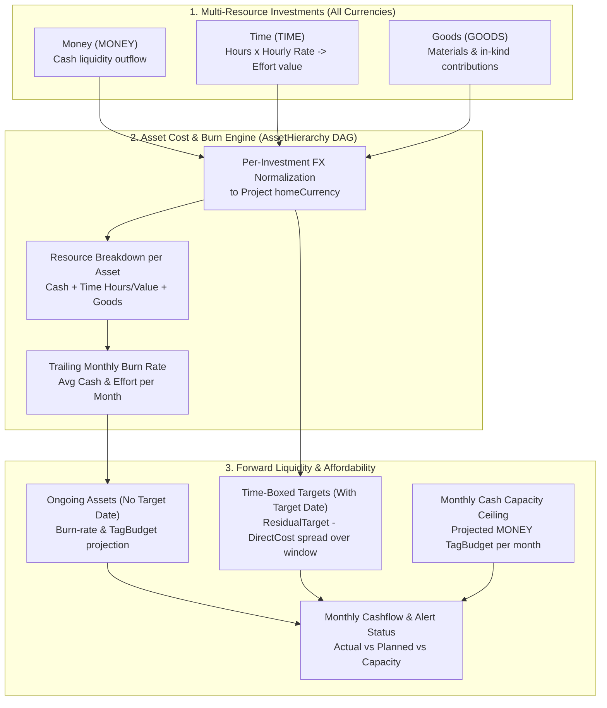

# Asset Cost Accounting, Planning & Cash Flow Forecasting Specification

## 1. Executive Summary & Core Concept

This specification defines the mathematical, domain, and UI architecture for **Projecta’s Asset Cost, Burn Rate & Cash Flow Forecasting Engine**.

Projecta is a **personal True Cost & Commitment tracker** built around one central question:

> **"What has owning, building, or maintaining *any* asset in my life actually cost me across Money, Time, and Goods—and what will sustaining or completing it cost going forward?"**

Here, an [`Asset`](file:///Users/maksym.hryshkov/Code/projecta/internal/asset/asset.go#L49-L70) can represent literally anything a person invests resources into: a physical possession (car, laptop, apartment), a finite acquisition or renovation, an ongoing hobby/health habit, or an open-ended personal commitment (including life areas or relationships).

Because real-life assets vary widely, the architecture rejects heavyweight enterprise project-management assumptions (such as mandatory `0% → 100%` completion percentages, Earned Value `CPI`/`SPI` formulas, or budget-transfer wizards) in favor of two natural asset modes sharing one DAG model:

1. **Ongoing / Open-Ended Assets** (`target_completion_date == NULL`, `target_price` optional):
   - Never completed and never given fake deadlines.
   - Tracked by **true cumulative cost** (`MONEY` + `TIME` hours & value + `GOODS`), **historical monthly burn rate**, and optional recurring category allowances via [`TagBudget`](file:///Users/maksym.hryshkov/Code/projecta/internal/project/tag_budget.go#L84-L98).
2. **Time-Boxed / Planned Assets** (`target_completion_date != NULL` and `target_price > 0`):
   - Represent planned acquisitions or finite initiatives with a target date and budget.
   - Spread remaining unspent target budgets cleanly across future months alongside ongoing burn and recurring `TagBudget` ceilings.



---

## 2. Capabilities & Coexistence with `TagBudget`

### 2.1. Capability Overview

```
┌──────────────────────────────────────────────────────────────────────────────┐
│                 ASSET COST ACCOUNTING, PLANNING & FORECASTING                │
├─────────────────────────────────┬────────────────────────────────────────────┤
│ 1. True Cost & Resource Mix     │ Per-investment FX conversion to home       │
│    (Money / Time / Goods)       │ currency; rolled-up Cash, Time & Goods     │
├─────────────────────────────────┼────────────────────────────────────────────┤
│ 2. Ongoing Burn Rate Analytics  │ Trailing monthly cash burn & hour velocity │
│    (Open-Ended Assets)          │ for perpetual/unbudgeted life assets       │
├─────────────────────────────────┼────────────────────────────────────────────┤
│ 3. Optional Target Windows      │ Invariant-guarded target_completion_date,  │
│    (Time-Boxed Goals)           │ DAG residual budgets, exact cent spread    │
├─────────────────────────────────┼────────────────────────────────────────────┤
│ 4. Affordability & Trend Board  │ Stacked Recharts cashflow + effort trend   │
│    (Frontend UX)                │ vs TagBudget ceilings & inline date edits  │
└─────────────────────────────────┴────────────────────────────────────────────┘
```

### 2.2. Coexistence of Planning Signals

| Signal Source | Mental Model | When It Applies | Role in Monthly Forecast |
| :--- | :--- | :--- | :--- |
| **`TagBudget` (`internal/project`)** | **Recurring Category Allowance / Funding Ceiling** (*"I allocate $1,500/mo to `#housing` and $400/mo to `#car`"*). | Recurring frequencies (`DAILY`, `WEEKLY`, `MONTHLY`, `ANNUALLY`, `ONCE`), bounded by `Project.StartDate`/`EndDate`. | Supplies per-month **Cash Capacity Ceiling ($C_{\text{monthly}}(M)$)** from `MONEY` rules. |
| **Time-Boxed Asset Target (`internal/asset`)** | **Finite Acquisition / Goal Outflow** (*"Buy & equip X by Oct 15 for $8,000; $3,000 spent so far"*). | Only when an active asset has `ResidualTarget > 0` **and** explicit `targetCompletionDate != nil`. | Projects `RemainingTarget(A)` evenly across `[max(Today, S_A), E_A]` (or current month if overdue). |
| **Ongoing Asset Burn (`internal/asset`)** | **Observed Lifestyle / Ownership Run-Rate** (*"Asset Y has averaged $420 + 8h/mo over the last 6 months"*). | Active open-ended assets (`targetCompletionDate == nil`), budgeted or unbudgeted. | Surfaces informational **Estimated Ongoing Burn** without triggering fake 30-day deficit cliffs. |

---

## 3. Feature 1: Accurate Multi-Resource Cost Truth & Monthly Burn Rate

### 3.1. Fixing Multi-Currency Aggregation in `AssetHierarchy`

Currently, [`PgAssetRepository.loadCompositionsAndRollup`](file:///Users/maksym.hryshkov/Code/projecta/pkg/dal/pg_asset_repository.go#L444-L465) sums raw `inv.amount * ia.share_percentage / 100.0` in SQL using `COALESCE(MAX(inv.currency), 'UAH')`—incorrectly adding minor units across mixed currencies (`USD` + `UAH` + `EUR`) and leaving [`Asset`](file:///Users/maksym.hryshkov/Code/projecta/internal/asset/asset.go#L49-L70) without `directCostHomeAmount` or a resource-type split.

For all cost truth, burn, and forecast calculations:
1. Read all allocated investments from `projecta_investments` joined with `projecta_investment_assets` (`share_percentage`).
2. Compute each allocated share (`round(inv.Amount * sharePercentage / 100.0)` and proportional `timeHours * sharePercentage / 100.0`).
3. Convert every monetary share into the project's `homeCurrency` using [`CurrencyConverter`](file:///Users/maksym.hryshkov/Code/projecta/internal/asset/valuation.go#L8-L10) **before** summing direct costs and rolling up [`AssetHierarchy`](file:///Users/maksym.hryshkov/Code/projecta/internal/asset/hierarchy.go#L28-L32).

### 3.2. Resource Breakdown (`MONEY` vs. `TIME` vs. `GOODS`)

Every asset computes both **direct** and **rolled-up** totals in `homeCurrency`, preserving non-monetary dimensions that define personal cost:

```go
type ResourceBreakdown struct {
    CashCents       int64   // MONEY investments converted to homeCurrency
    TimeCents       int64   // TIME valuation (hours * rate) converted to homeCurrency
    TimeHours       float64 // Total hours invested across TIME records
    GoodsCents      int64   // GOODS valuation converted to homeCurrency
    TotalCostCents  int64   // CashCents + TimeCents + GoodsCents
}
```

- **Why keep `TIME` hours explicit**: Knowing a personal asset or relationship cost `180 hours` alongside `$2,400` in cash gives the user the real picture without muddling bank liquidity forecasts.
- **Unbudgeted assets stay first-class**: An asset with `TargetPrice == nil` (including legacy `'General Operations'` rows from [`000032`](file:///Users/maksym.hryshkov/Code/projecta/migrations/000032_asset_investments_redesign.up.sql#L95-L111) and ongoing assets) computes full `ResourceBreakdown` and burn metrics cleanly.

### 3.3. Trailing Monthly Burn Rate ($\text{Burn}(A)$)

To answer *"What does maintaining X cost me per month?"* without extrapolating a single Day-1 expense to 30× its size:

Let lookback window $K = 6$ calendar months ending at the current month $M_{\text{now}}$:
1. Normalize timestamps to UTC calendar months.
2. Let $S_A^{\text{eff}}$ be $\min(\text{toUTCDate}(S_A), \text{earliestInvestmentDate}(A))$ converted to its calendar month $M_{\text{start}}(A)$, and let active span months $N_{\text{elapsed}}(A)$ be the count of calendar months in $[\max(M_{\text{start}}(A), M_{\text{now}} - K + 1), M_{\text{now}}]$ inclusive (bounded to $[1, K]$).
   - *(Notice: dividing by full calendar months `max(1, N_elapsed)`—rather than elapsed days—prevents spending `$200` on Day 1 of the month from displaying a `$6,000/month` run-rate.)*
3. Sum direct investments allocated to $A$ within those $N_{\text{elapsed}}(A)$ months (`CashLookback`, `TimeLookback`, `TimeHoursLookback`, `GoodsLookback`):
   $$\text{MonthlyCashBurn}(A) = \text{round}\left(\frac{\text{CashLookback}(A)}{N_{\text{elapsed}}(A)}\right)$$
   $$\text{MonthlyTotalBurn}(A) = \text{round}\left(\frac{\text{TotalLookback}(A)}{N_{\text{elapsed}}(A)}\right), \quad \text{MonthlyHoursBurn}(A) = \frac{\text{TimeHoursLookback}(A)}{N_{\text{elapsed}}(A)}$$

*(For composite parents, rolled-up burn sums `Burn(A) + sum_{C in Children(A)} Burn(C) * Share(A, C) / 100`, preventing DAG double-counting.)*

---

## 4. Feature 2: Optional Lifecycle Window (`targetCompletionDate`)

### 4.1. Domain Model Extensions (`internal/asset/asset.go`)

[`Asset`](file:///Users/maksym.hryshkov/Code/projecta/internal/asset/asset.go#L49-L70) is extended minimally with unexported fields and defensive-copy getters per [`docs/ddd-development-guidelines.md`](file:///Users/maksym.hryshkov/Code/projecta/docs/ddd-development-guidelines.md#L59-L63):
- `targetCompletionDate *time.Time`: Optional planned finish date (`nil` for ongoing/perpetual assets; defensively copied via `copyTimePtr`).
- `directCostHomeAmount int64`: Home-currency sum of direct investments allocated to this asset.
- Existing financial budget ratio `progressPercentage *float64` (`TotalCost / TargetPrice * 100`) stays intact; **no manual `physicalProgress` field is added**.

```go
type Asset struct {
    id                   core.AssetID
    name                 string
    description          string
    projectID            core.ProjectID
    price                *money.Money
    acquiredAt           time.Time
    owner                OwnerRef
    status               AssetStatus
    startDate            time.Time
    targetCompletionDate *time.Time  // Optional deadline (nil for ongoing/perpetual assets)
    completedDate        *time.Time  // Actual completion date
    targetPrice          *money.Money
    directCost           *money.Money
    totalCost            *money.Money
    homeCurrency         string
    homeAmount           int64
    directCostHomeAmount int64       // Computed direct investments converted to homeCurrency
    targetHomeAmount     *int64
    progressPercentage   *float64    // Financial spend %: (TotalCost / TargetPrice) * 100
    children             []ChildAssetLink
    parents              []ParentAssetLink
    tags                 []string
}
```

### 4.2. Business Invariants

1. **Temporal Sequence Invariant**:
   - Let $\text{toUTCDate}(t) = \text{time.Date}(t.\text{UTC}().\text{Date}(), 0, 0, 0, 0, \text{time.UTC})$.
   - If `targetCompletionDate != nil` and `!startDate.IsZero()`, then `toUTCDate(*targetCompletionDate)` must not be before `toUTCDate(startDate)`.
   - Violations return `exceptions.NewValidationException("target completion date cannot be before start date", nil)`.
2. **Ongoing Assets Stay Undated**:
   - Creating or updating an ongoing asset with `targetCompletionDate == nil` is valid. Transitioning via `Complete(completedAt)` sets `status = COMPLETED`, `completedDate = &completedAt`, removing it from active future cash demand.
3. **Zero-Target & `AssetGroup` Compatibility**:
   - Existing [`CreateAssetGroup`](file:///Users/maksym.hryshkov/Code/projecta/internal/asset/asset.go#L282-L305) creates `0 UAH` group parents, and migrated `'General Operations'` rows have `targetPrice == nil`. Updating schedule dates via `PATCH /schedule` must work for both budgeted and unbudgeted/group assets, and `UpdateDetails` / [`decodeUpdateAssetRequest`](file:///Users/maksym.hryshkov/Code/projecta/pkg/web/assets.go#L480-L486) should allow preserving `0` / `nil` targets on unbudgeted or group assets.
4. **DAG Schedule Bounding Warnings (Non-Blocking)**:
   - If a child asset $C$ has a parent $P$ with bounded window $[S_P, E_P]$, flag a non-blocking warning when $S_C < S_P$ or ($E_P \neq \text{nil}$ and ($E_C == \text{nil}$ or $E_C > E_P$)).
5. **Backwards-Compatible Schedule Command**:
   - Existing [`Asset.Reschedule(startDate)`](file:///Users/maksym.hryshkov/Code/projecta/internal/asset/asset.go#L521-L526) is called by [`ServiceImpl.Update`](file:///Users/maksym.hryshkov/Code/projecta/internal/asset/service.go#L348-L352). Add `UpdateSchedule(startDate *time.Time, targetCompletionDate *time.Time, clearTargetDate bool) error` on `Asset` (keeping `Reschedule` delegating safely to preserve existing callers and tests):

```go
type RescheduleAssetCommand struct {
    AssetID              core.AssetID
    ProjectID            core.ProjectID
    StartDate            *time.Time
    TargetCompletionDate *time.Time
    ClearTargetDate      bool
}
```

---

## 5. Feature 3: Residual Cash Demand & Affordability Forecasting

### 5.1. Residual DAG Target ($\text{ResidualTarget}(A)$)

To support hierarchical asset breakdowns without double-counting child targets inside parent budgets or losing unallocated parent buffers:

For every asset $A$ in [`AssetHierarchy`](file:///Users/maksym.hryshkov/Code/projecta/internal/asset/hierarchy.go#L28-L32), convert `TargetPrice(A)` into project `homeCurrency` ($\text{TargetPrice}_{\text{home}}(A) = 0$ if `nil` or `<= 0`):
$$\text{AllocatedToChildren}(A) = \sum_{C \in \text{Children}(A)} \text{round}\left(\text{TargetPrice}_{\text{home}}(C) \times \frac{\text{Share}(A, C)}{100}\right)$$
$$\text{ResidualTarget}(A) = \max\left(0, \text{TargetPrice}_{\text{home}}(A) - \text{AllocatedToChildren}(A)\right)$$

- **DAG Share Partition Invariant**: When child $C$ sits under budgeted parents ($\text{TargetPrice}_{\text{home}}(P) > 0$), parent shares $\sum_{P \in \text{Parents}(C)} \text{Share}(P, C)$ should total $100\%$ (if `< 100%`, only the linked share is deducted from the parent while $C$'s full residual remains counted; zero-target `AssetGroup` parents always yield $\text{ResidualTarget} = 0$).

### 5.2. Scheduled Deliverable Cash Demand (Strictly for Dated Targets)

Only assets with an **explicit planned target date** (`targetCompletionDate != nil`), `status == ACTIVE`, and $\text{ResidualTarget}(A) > 0$ generate future target-spread cash demand:

$$\text{RemainingTarget}(A) = \max\left(0, \text{ResidualTarget}(A) - \text{DirectCost}_{\text{home}}(A)\right)$$

*(Ongoing assets with `targetCompletionDate == nil` are intentionally excluded here so lifetime targets never create synthetic 30-day cliffs; their monthly expectations appear via ongoing burn and `TagBudget` rules.)*

Let $T_{\text{today}} = \text{toUTCDate}(\text{Now})$ and $E_A = \text{toUTCDate}(*\text{targetCompletionDate}_A)$:
- **Overdue Dated Target ($E_A < T_{\text{today}}$ with $\text{RemainingTarget}(A) > 0$)**:
  - Flag `is_overdue = true` in the monthly breakdown and assign $\text{RemainingTarget}(A)$ entirely to the **current month $M_{\text{now}}$** (explicit past-due balance rather than disappearing into the past or fabricating a 30-day extension).
- **Active Future/Current Window ($E_A \ge T_{\text{today}}$)**:
  - $S_A^{\text{rem}} = \max(T_{\text{today}}, \text{toUTCDate}(S_A))$, $E_A^{\text{rem}} = E_A$.
  - Total inclusive remaining calendar days: $D_{\text{rem}}(A) = \text{daysBetween}(S_A^{\text{rem}}, E_A^{\text{rem}}) + 1 \ge 1$.
  - Overlap days with month $M = [T_{\text{start}}^M, T_{\text{end}}^M]$ (UTC dates):
    $$\text{OverlapDays}(A, M) = \begin{cases} \text{daysBetween}(\max(S_A^{\text{rem}}, T_{\text{start}}^M), \min(E_A^{\text{rem}}, T_{\text{end}}^M)) + 1, & \text{if } \max \le \min \\ 0, & \text{otherwise} \end{cases}$$
  - **Exact Cumulative Cent Conservation** across ordered overlapping months $M_1, \dots, M_k$:
    $$\text{CumulAllocated}(A, M_j) = \text{round}\left(\text{RemainingTarget}(A) \times \frac{\sum_{i=1}^{j} \text{OverlapDays}(A, M_i)}{D_{\text{rem}}(A)}\right)$$
    $$\text{AssetMonthDemand}(A, M_j) = \text{CumulAllocated}(A, M_j) - \text{CumulAllocated}(A, M_{j-1})$$
    *(Guarantees $\sum_M \text{AssetMonthDemand}(A, M) == \text{RemainingTarget}(A)$ with zero rounding drift.)*

### 5.3. Ongoing Burn Projection, Monthly Horizon & Peak Alert Status

Output months span $[M_{\text{start}}, M_{\text{end}}]$, covering all months with historical investments, the current month $M_{\text{now}}$, bounded project dates, and the farthest active `targetCompletionDate` (capped at a safe horizon, e.g., 60 months forward; defaulting to 6 months forward if only ongoing assets exist).

For each month $M$:
- **Historical Actuals**: `ActualCashCents(M)` (`MONEY`), `ActualTimeCents(M)` (`TIME`), `ActualTimeHours(M)`, `ActualGoodsCents(M)` (`GOODS`) summed from allocated investments in month $M$.
- **Scheduled Demand**: $\text{ScheduledDemand}(M) = \sum_{A \in \text{DatedTargets}} \text{AssetMonthDemand}(A, M)$.
- **Informational Ongoing Burn Projection** (for future months $M > M_{\text{now}}$):
  $$\text{EstimatedOngoingCash}(M) = \sum_{A \in \text{OngoingActive}} \text{MonthlyCashBurn}(A)$$
  Surfaced separately on the chart (toggleable) so sustained lifestyle/maintenance costs can be viewed alongside scheduled goals without corrupting current-month `ActualCash`.
- **Per-Month Capacity Ceiling ($C_{\text{monthly}}(M)$)**: Sum of `ProjectedHomeAmountForMonth` across active `MONEY` [`TagBudget`](file:///Users/maksym.hryshkov/Code/projecta/internal/project/tag_budget.go#L295-L297) rules in month $M$ (respecting `Project.StartDate`/`EndDate` and `ONCE`/`DAILY`/`WEEKLY`/`MONTHLY`/`ANNUALLY` schedules).
- **Affordability Alert Status**:
  $$\text{CommittedCashOutflow}(M) = \text{ActualCash}(M) + \text{ScheduledDemand}(M)$$
  $$\text{AlertStatus}(M) = \begin{cases}
  \text{NORMAL}, & \text{if } C_{\text{monthly}}(M) == \text{nil or } \le 0 \text{ or } \text{CommittedCashOutflow}(M) \le C_{\text{monthly}}(M) \\
  \text{PEAK\_SPEND\_WARNING}, & \text{if } C_{\text{monthly}}(M) < \text{CommittedCashOutflow}(M) \le 1.25 \times C_{\text{monthly}}(M) \\
  \text{CRITICAL\_DEFICIT}, & \text{if } \text{CommittedCashOutflow}(M) > 1.25 \times C_{\text{monthly}}(M)
  \end{cases}$$

### 5.4. Reality vs. Target Variance (Honest Accounting)

- **No silent target mutation**: Existing `Complete()` / `Reopen()` lifecycle transitions in [`internal/asset/asset.go`](file:///Users/maksym.hryshkov/Code/projecta/internal/asset/asset.go#L540-L549) preserve `TargetPrice` untouched so expected cost vs. realized `TotalCost` stays honest (`Variance = TargetHome - TotalCostHome`).
- Over-target completed or active assets continue using Projecta's existing over-budget visual indicator (`progressPercentage > 100%` in [`Asset.js`](file:///Users/maksym.hryshkov/Code/projecta/web-ui/src/models/Asset.js#L80-L94)).

### 5.5. Domain Service Specification (`internal/asset/valuation.go`)

```go
type MonthActualSummary struct {
    CashCents  int64
    TimeCents  int64
    TimeHours  float64
    GoodsCents int64
}

type AssetDemandItem struct {
    AssetID     core.AssetID
    AssetName   string
    AmountCents int64
    IsOverdue   bool
}

type MonthCashFlow struct {
    YearMonth                string            // e.g. "2026-08"
    ActualCashCents          int64
    ActualTimeCents          int64
    ActualTimeHours          float64
    ActualGoodsCents         int64
    ScheduledDemandCents     int64             // Finite dated assets
    EstimatedOngoingCashCents int64            // Future-month trailing burn of undated active assets
    MonthlyLimitCents        *int64            // Per-month MONEY TagBudget ceiling (nil if unset)
    AlertStatus              string            // "NORMAL" | "PEAK_SPEND_WARNING" | "CRITICAL_DEFICIT"
    AssetBreakdown           []AssetDemandItem
}
```

---

## 6. Feature 4: Frontend Experience & Layered Architecture

Following [`docs/frontend-design-principals.md`](file:///Users/maksym.hryshkov/Code/projecta/docs/frontend-design-principals.md) and Projecta's existing UI stack (`React 19`, `Recharts`, `intlayer`, Tailwind/Radix in [`web-ui/package.json`](file:///Users/maksym.hryshkov/Code/projecta/web-ui/package.json)):

### 6.1. Integrated Project Planning & Cost View

```
+---------------------------------------------------------------------------------------------------+
|  PROJECT COST TRUTH & CASH FLOW FORECAST                        [ Include Time/Goods ] [ Ongoing ]|
+---------------------------------------------------------------------------------------------------+
|  SUMMARY CARDS:                                                                                   |
|  Total Realized: $14,200 + 84h | Cash Burn Avg: $1,150/mo | Scheduled Remaining: $5,000 | vs Plan |
+---------------------------------------------------------------------------------------------------+
|  TIER 1: ASSET COST, BURN & SCHEDULE TABLE (All Assets — Bounded & Ongoing)                       |
|  Asset                Mode        Total (Cash / Time / Goods)   Burn/mo   Target Window   Variance|
|  ├─ Daily Operations  Ongoing     $4,200 ($2.9k / 32h / $0.4k)  $700/mo   [Set end date]  —       |
|  ├─ Primary Vehicle   Ongoing     $3,500 ($3.2k / 8h  / $0.1k)  $450/mo   [Set end date]  -$500   |
|  └─ Kitchen Remodel   Scheduled   $6,500 ($5.1k / 44h / $0.5k)  —         Aug 1 → Oct 15  $2k left|
+---------------------------------------------------------------------------------------------------+
|  TIER 2: MONTHLY CASH FLOW & RESOURCE TREND (Recharts ComposedChart)                              |
|  Stacked Bars: Actual Cash | Actual Time/Goods (opt) | Scheduled Target Demand | Ongoing Burn Est |
|  Reference Line: Per-Month MONEY TagBudget Ceiling (Alert highlights on PEAK_SPEND / DEFICIT)     |
+---------------------------------------------------------------------------------------------------+
```

- **Simple inline date editing instead of bespoke drag-and-drop Gantt physics**: Clicking `Target Window` lets users set, adjust, or clear `target_completion_date` cleanly (immediately recalculating remaining monthly spread via pure JS `CashFlowCalculator.js` before saving via `PATCH /schedule`).
- **Router & Navigation Integration**:
  - Register a child route (`planning`) under `/projects/:projectId` in [`web-ui/src/router/routes.js`](file:///Users/maksym.hryshkov/Code/projecta/web-ui/src/router/routes.js#L69-L100).
  - Add a navigation item and localized label in [`ProjectDetails.jsx`](file:///Users/maksym.hryshkov/Code/projecta/web-ui/src/components/Projects/ProjectDetails.jsx#L61-L86).
- **Unpaginated Asset Fetch**: [`decodeListAssetsRequest`](file:///Users/maksym.hryshkov/Code/projecta/pkg/web/assets.go#L560) defaults `limit=10`; `CashFlowBoard` uses the dedicated `GET /cashflow-forecast` endpoint (or explicit unpaginated fetch) so client recalculations always see the full DAG.

### 6.2. Frontend File Layout

```
web-ui/src/components/Projects/CashFlow/
├── CashFlowBoard.jsx             # Container & summary KPI cards
├── CashFlowBoard.content.js      # Intlayer i18n dictionary
├── AssetCostBurnTable.jsx        # Humble View: Total Cost, Cash/Time/Goods mix, Burn/mo, inline date editor
└── MonthlyCashFlowChart.jsx      # Humble View: Recharts ComposedChart (Actual + Scheduled + Burn + Limit)

web-ui/src/hooks/
└── useProjectCashFlow.js         # State Machine: loads forecast, optimistic inline schedule edits & rollback

web-ui/src/models/
└── CashFlowCalculator.js         # Pure JS Domain: ResidualTarget, UTC cent-conserved overlap, burn helper
```

---

## 7. Technical Architecture, Migration & API Contracts

### 7.1. Database Schema Migration & Deployment Notes

Latest existing migration: [`migrations/000036_add_currency_to_project_tag_budgets.up.sql`](file:///Users/maksym.hryshkov/Code/projecta/migrations/000036_add_currency_to_project_tag_budgets.up.sql). New migration `000037` adds only `target_completion_date` on **`projecta_assets`** using **`TIMESTAMP`** (matching `000001`–`000036`):

- **Up Migration**: `migrations/000037_add_asset_target_completion_date.up.sql`
  ```sql
  ALTER TABLE projecta_assets
      ADD COLUMN IF NOT EXISTS target_completion_date TIMESTAMP DEFAULT NULL;

  CREATE INDEX IF NOT EXISTS idx_projecta_assets_project_schedule
      ON projecta_assets (project_id, start_date, target_completion_date);
  ```

- **Down Migration**: `migrations/000037_add_asset_target_completion_date.down.sql`
  ```sql
  DROP INDEX IF EXISTS idx_projecta_assets_project_schedule;

  ALTER TABLE projecta_assets
      DROP COLUMN IF EXISTS target_completion_date;
  ```

- **Deploy Safety, Legacy Compatibility & DAL Ripple**:
  1. **Zero-Downtime CI/CD Safety**: [`.gitlab-ci.yml`](file:///Users/maksym.hryshkov/Code/projecta/.gitlab-ci.yml#L127-L130) runs `./projecta-migrate` **before** restarting `projecta`. A nullable `DEFAULT NULL` column is backwards-compatible with the prior binary during deployment.
  2. **Zero Legacy Backfill Shock**: All existing `ACTIVE`, `COMPLETED`, `'General Operations'`, and `AssetGroup` rows start cleanly with `target_completion_date = NULL` (no synthetic progress numbers or guessed deadlines needed).
  3. **DAL & Test Lockstep**: Update [`PgAssetRepository`](file:///Users/maksym.hryshkov/Code/projecta/pkg/dal/pg_asset_repository.go) (`Save`, `setupSelectQueryBuilder` moving from 13 to 14 columns, `FindOne`, `Find`, `toAssetFromPg`), `ReconstituteAsset`, and hardcoded 13-element row slices in [`pkg/dal/dal_test.go`](file:///Users/maksym.hryshkov/Code/projecta/pkg/dal/dal_test.go#L714-L740).

### 7.2. Cross-Context Ports in `internal/asset/ports.go`

Extend existing [`ProjectReader`](file:///Users/maksym.hryshkov/Code/projecta/internal/asset/ports.go#L68-L71) (avoiding duplicate reader interfaces) and bridge via [`cmd/web/adapters.go`](file:///Users/maksym.hryshkov/Code/projecta/cmd/web/adapters.go):

```go
type ProjectDescriptor struct {
    ID           core.ProjectID
    MainCurrency string
    StartDate    time.Time
    EndDate      time.Time
}

type ProjectReader interface {
    FindProject(ctx context.Context, projectID core.ProjectID) (ProjectDescriptor, error)
    // FindMonthlyCashCeilings returns per-month MONEY TagBudget totals in home currency ("YYYY-MM" -> cents).
    FindMonthlyCashCeilings(ctx context.Context, projectID core.ProjectID, months []string) (map[string]int64, error)
}
```

Extend [`InvestmentSource`](file:///Users/maksym.hryshkov/Code/projecta/internal/asset/ports.go#L56-L60) with an unpaginated project allocation query so all multi-currency conversions happen accurately per investment share:

```go
type InvestmentAllocation struct {
    AssetID         core.AssetID
    SharePercentage float64
}

type InvestmentRecordSummary struct {
    ID           core.InvestmentID
    Amount       *money.Money
    ResourceType string                 // "MONEY" | "TIME" | "GOODS"
    TimeHours    *float64
    Date         time.Time
    Allocations  []InvestmentAllocation // From projecta_investment_assets
}

type InvestmentSource interface {
    // ... existing methods ...
    ListProjectInvestments(ctx context.Context, projectID core.ProjectID) ([]InvestmentRecordSummary, error)
}
```

### 7.3. REST API Contracts (`pkg/web/`)

> **Routing Note**: [`pkg/web/handler.go`](file:///Users/maksym.hryshkov/Code/projecta/pkg/web/handler.go#L257-L333) mounts backend routes **without** the `/api` prefix; [`docker/nginx.conf`](file:///Users/maksym.hryshkov/Code/projecta/docker/nginx.conf#L12-L14) strips `/api/` before forwarding from the frontend. Update [`AssetDTO`](file:///Users/maksym.hryshkov/Code/projecta/pkg/web/assets.go#L66-L89) with `target_completion_date`, `direct_cost_home_amount`, `resource_breakdown`, and `schedule_warnings`.

#### 1. Update Asset Schedule Window
- **Endpoint**: `PATCH /projects/{project_id}/assets/{asset_id}/schedule` *(UI calls `/api/projects/...`)*
- **Request Body**:
  ```json
  {
    "start_date": "2026-08-01T00:00:00Z",
    "target_completion_date": "2026-10-15T00:00:00Z",
    "clear_target_date": false
  }
  ```
- **Response**: `200 OK` (Updated `AssetDTO` including non-blocking `schedule_warnings`).

#### 2. Get Project Cost Breakdown, Burn & Cash Flow Forecast
- **Endpoint**: `GET /projects/{project_id}/cashflow-forecast` *(optional `?from=YYYY-MM&to=YYYY-MM&burn_months=6`)*
- **Response**:
  ```json
  {
    "home_currency": "USD",
    "summary": {
      "total_realized_cents": 1420000,
      "total_cash_cents": 1120000,
      "total_time_cents": 200000,
      "total_time_hours": 84.0,
      "total_goods_cents": 100000,
      "scheduled_target_total_cents": 850000,
      "scheduled_remaining_cents": 200000,
      "ongoing_monthly_cash_burn_cents": 115000,
      "ongoing_monthly_total_burn_cents": 145000
    },
    "assets": [
      {
        "asset_id": "...",
        "name": "Kitchen Remodel",
        "status": "ACTIVE",
        "start_date": "2026-08-01T00:00:00Z",
        "target_completion_date": "2026-10-15T00:00:00Z",
        "target_home_amount": 850000,
        "residual_target_cents": 850000,
        "remaining_target_cents": 200000,
        "direct_breakdown": {
          "cash_cents": 510000,
          "time_cents": 90000,
          "time_hours": 44.0,
          "goods_cents": 50000,
          "total_cost_cents": 650000
        },
        "total_breakdown": {
          "cash_cents": 510000,
          "time_cents": 90000,
          "time_hours": 44.0,
          "goods_cents": 50000,
          "total_cost_cents": 650000
        },
        "monthly_burn": {
          "cash_cents": 0,
          "total_cents": 0,
          "time_hours": 0.0
        },
        "schedule_warnings": []
      }
    ],
    "months": [
      {
        "year_month": "2026-08",
        "actual_cash_cents": 350000,
        "actual_time_cents": 45000,
        "actual_time_hours": 22.0,
        "actual_goods_cents": 0,
        "scheduled_demand_cents": 100000,
        "estimated_ongoing_cash_cents": 0,
        "monthly_limit_cents": 500000,
        "alert_status": "NORMAL",
        "assets": [
          { "asset_id": "...", "asset_name": "Kitchen Remodel", "amount_cents": 100000, "is_overdue": false }
        ]
      }
    ]
  }
  ```

---

## 8. Phased Implementation & Verification Plan

```
Phase 1: Schema, Currency-Safe Cost Truth & Schedule Dates
                       │
                       ▼
Phase 2: Burn Rate, Residual Cash Flow & API Endpoints
                       │
                       ▼
Phase 3: Project Planning & Cash Flow Dashboard (Web UI)
```

### Phase 1: Schema, Cost Truth & Optional Target Dates
1. Add `000037_add_asset_target_completion_date.up.sql` and `.down.sql` in [`migrations/`](file:///Users/maksym.hryshkov/Code/projecta/migrations/).
2. Extend [`Asset`](file:///Users/maksym.hryshkov/Code/projecta/internal/asset/asset.go#L49-L70) with `targetCompletionDate`, temporal validation, `UpdateSchedule`, and [`PgAssetRepository`](file:///Users/maksym.hryshkov/Code/projecta/pkg/dal/pg_asset_repository.go) + [`pkg/dal/dal_test.go`](file:///Users/maksym.hryshkov/Code/projecta/pkg/dal/dal_test.go#L714-L740) updates.
3. Add per-investment FX normalization and `ResourceBreakdown` (`MONEY` / `TIME` hours + value / `GOODS`) rollup in [`internal/asset/`](file:///Users/maksym.hryshkov/Code/projecta/internal/asset/) via [`InvestmentSource.ListProjectInvestments`](file:///Users/maksym.hryshkov/Code/projecta/internal/asset/ports.go#L56-L60) (and resolve `PgAssetRepository` mixed-currency aggregation).
- **Verify**: `go test -race -count=1 ./internal/asset/... ./pkg/dal/...`

### Phase 2: Burn Rate, Residual Demand Forecast & Web Contracts
1. Implement `CalculateResidualTargets`, trailing `CalculateAssetBurnRates`, and UTC exact-cent `CalculateCashFlowSchedule` in [`internal/asset/valuation.go`](file:///Users/maksym.hryshkov/Code/projecta/internal/asset/valuation.go).
2. Extend [`ProjectReader`](file:///Users/maksym.hryshkov/Code/projecta/internal/asset/ports.go#L68-L71) and [`cmd/web/adapters.go`](file:///Users/maksym.hryshkov/Code/projecta/cmd/web/adapters.go) to supply per-month `MONEY` `TagBudget` ceilings (`map[string]int64`).
3. Expose `PATCH /projects/{project_id}/assets/{asset_id}/schedule` and `GET /projects/{project_id}/cashflow-forecast` in [`pkg/web/`](file:///Users/maksym.hryshkov/Code/projecta/pkg/web/), updating `AssetDTO` (`target_completion_date`, `direct_cost_home_amount`, `resource_breakdown`).
- **Verify**:
  - Table-driven unit tests covering mixed-currency DAG rollups, unbudgeted/ongoing assets with burn calculation, partially decomposed parents (no double-counting, no dropped unallocated buffer), overdue dated targets, and exact cumulative cent conservation.
  - DDD boundary checks (`go list` / `grep` rules) and `go test -v -coverprofile=coverage.out ./internal/... ./pkg/... ./cmd/...` meeting [`.gitlab-ci.yml`](file:///Users/maksym.hryshkov/Code/projecta/.gitlab-ci.yml#L59-L65) `>= 95.0%` coverage.

### Phase 3: Cost Truth, Burn & Cash Flow Dashboard (Frontend)
1. Implement pure JS `CashFlowCalculator.js` in `web-ui/src/models/` mirroring residual target, UTC overlap, and burn math.
2. Build `CashFlowBoard.jsx`, `AssetCostBurnTable.jsx`, `MonthlyCashFlowChart.jsx` (`Recharts`), and `CashFlowBoard.content.js` (`intlayer`), wired into [`routes.js`](file:///Users/maksym.hryshkov/Code/projecta/web-ui/src/router/routes.js#L69-L100) and [`ProjectDetails.jsx`](file:///Users/maksym.hryshkov/Code/projecta/web-ui/src/components/Projects/ProjectDetails.jsx#L61-L86).
3. Implement `useProjectCashFlow.js` hook for inline schedule updates with optimistic chart refresh & rollback.
- **Verify**:
  - `node --test web-ui/src/models/CashFlowCalculator.test.js` (matching [`ProjectBudget.test.js`](file:///Users/maksym.hryshkov/Code/projecta/web-ui/src/models/ProjectBudget.test.js#L1-L3) and [`docs/ddd-development-guidelines.md`](file:///Users/maksym.hryshkov/Code/projecta/docs/ddd-development-guidelines.md#L303)).
  - `npm --prefix web-ui run lint && npm --prefix web-ui run build`.

---

## 9. Optional Future Extension: Bounded Project Execution Mode

If Projecta later adds an explicit project-management mode for multi-phase builds (e.g., construction/renovation workflows needing `%` completion tracking or Earned Value projections), that layer can be added non-invasively on top of this foundation without affecting perpetual asset tracking:
- Store `physical_progress DOUBLE PRECISION DEFAULT NULL` (only enabled when a user opts a dated deliverable into progress tracking).
- Scope `EV`, `PV`, `SPI`, and `EAC` strictly to opted-in dated deliverables (`target_completion_date != nil && physical_progress != nil`), leaving ongoing life/cost-center assets completely unaffected.
