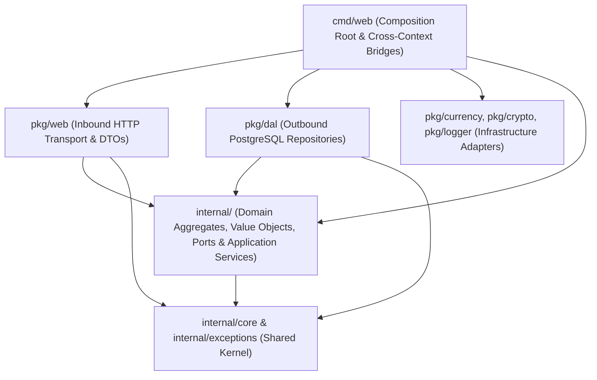

# Domain-Driven Design (DDD) Development Guidelines

This document is the authoritative engineering reference for Domain-Driven Design (DDD), Clean Architecture, and SOLID principles in the Projecta backend (`internal/`, `pkg/`, `cmd/`). It consolidates the architectural patterns, implementation rules, and verification checks established across all bounded contexts.

---

## 1. Core Architectural Philosophy & Layering

### 1.1. Bounded Context Autonomy
Projecta is organized into autonomous bounded contexts under `internal/`:
- **`internal/project`**: Project lifecycle, ownership, participant sharing, and multi-currency tag budget schedules (`Project`, `TagBudget`, `Participant`, `Owner`).
- **`internal/asset`**: Project assets, hierarchical DAG compositions, and cost rollups (`Asset`, `AssetHierarchy`).
- **`internal/investment`**: Financial, time, and goods contributions allocated across project assets (`Investment`, `InvestmentAssetLink`).
- **`internal/people`**: Identity, authentication strategies, roles, and invitations (`Person`, `Credentials`, `DisplayName`, `Invitation`).
- **`internal/statement`**: Bank statement parsing and duplicate transaction detection (`StatementService`).

**Golden Rule of Context Isolation**:
> A bounded context package under `internal/` must **never** import another bounded context package. Cross-context collaboration happens exclusively through narrow, consumer-owned ports defined in the calling context and bridged by adapters in the composition root (`cmd/web/adapters.go`).

### 1.2. Shared Kernel Purity (`internal/core` & `internal/exceptions`)
- `internal/core` and `internal/exceptions` form the Shared Kernel and may be imported by any layer.
- **Zero Infrastructure or Transport Leaks**: `internal/core` and `internal/exceptions` must never import `database/sql`, `encoding/json`, `log`, or `pkg/*`, and must never contain `json:"..."` struct tags.
- **Strongly-Typed Aggregate Identifiers**: All aggregate roots use dedicated ID types defined in `internal/core/ids.go` (`core.PersonID`, `core.ProjectID`, `core.AssetID`, `core.InvestmentID`, `core.InvitationID`) rather than raw `uuid.UUID` or `string`.

### 1.3. Strict Layer Dependency Direction



| Layer | Location | Allowed Dependencies | Forbidden Dependencies |
| :--- | :--- | :--- | :--- |
| **Shared Kernel** | `internal/core`, `internal/exceptions` | Go stdlib (`context`, `errors`, `time`), `google/uuid` | `database/sql`, `encoding/json`, `log`, `pkg/*`, other `internal/*` |
| **Domain & App** | `internal/<context>` | `internal/core`, `internal/exceptions`, `go-money`, `google/uuid` | Other `internal/<context>`, `pkg/*`, `database/sql`, `encoding/json`, `log`, `net/http` |
| **Persistence (DAL)** | `pkg/dal` | `internal/<context>`, `internal/core`, `internal/exceptions`, `pgx`, `go-sqlbuilder` | `pkg/web`, `core.AuthGuard(ctx)` |
| **HTTP Transport** | `pkg/web` | Own context's `internal/<context>`, `internal/core`, `internal/exceptions`, `go-kit`, `mux` | Foreign `internal/<context>` for resource commands, `pkg/dal`, `pkg/currency` |
| **Composition Root** | `cmd/web` | All `internal/*` and `pkg/*` packages | — |

---

## 2. Aggregate Root & Value Object Design Rules

### 2.1. Encapsulation & Private State
Aggregates protect their business invariants at all times.
- **Unexported Fields**: Every struct field on an Aggregate Root (`Project`, `Asset`, `Investment`, `Person`, `Invitation`) and Value Object (`TagBudget`, `Participant`, `DisplayName`, `Credentials`) must be unexported (private).
- **Read-Only Getters**: Expose state via getters (`ID()`, `Name()`, `Amount()`, `MainCurrency()`). Never expose raw setters that bypass invariant validation.

### 2.2. Defensive Copying for Slices & Pointers
Aggregates must never leak internal mutable references (slices, maps, or pointers to mutable structs/primitives) through constructors, mutation methods, or getters:

```go
// Slice Getter: always return a copy
func (p *Project) TagBudgets() []TagBudget {
	if p.tagBudgets == nil {
		return make([]TagBudget, 0)
	}
	cp := make([]TagBudget, len(p.tagBudgets))
	copy(cp, p.tagBudgets)
	return cp
}

// Pointer Getter & Constructor Input: always copy pointer values
func copyOwner(o *Owner) *Owner {
	if o == nil {
		return nil
	}
	cp := *o
	return &cp
}

func (p *Project) Owner() *Owner {
	return copyOwner(p.owner)
}
```
Apply pointer defensive helpers (`copyTimePtr`, `copyFloat64Ptr`, `copyInt64Ptr`, `copyOwner`) both when accepting pointers into constructors/mutators and when returning them from getters.

### 2.3. Reference Other Aggregates by Identity Only
An aggregate must **never** hold a direct pointer to another aggregate root from a different context or lifecycle (e.g., `Investment` must never hold `*asset.Asset` or `*project.Project`).
- Reference related aggregates strictly by their strongly-typed ID (`core.ProjectID`, `core.AssetID`, `core.PersonID`) and immutable snapshot value objects (`OwnerRef`, `ContributorRef`, `InvestmentAssetLink`).

### 2.4. Creation Constructors vs. Persistence Reconstitution Factories
Separate domain creation from database hydration:
1. **Domain Creation Constructor (`New<Entity>` / `Create<Entity>`)**:
   - Enforces all business invariants (non-empty names, positive monetary amounts, valid currencies, valid date ordering, valid share percentages).
   - Generates defaults (e.g., new ID if nil, default `"UAH"` currency, share tokens).
   - Returns `(*Entity, error)` where validation failures return `exceptions.NewValidationException(...)`.
2. **Persistence Reconstitution Factory (`Reconstitute<Entity>`)**:
   - Hydrates an entity from trusted database records without running business validation or generating new timestamps/tokens.
   - Defensively copies slice and pointer inputs.
   - Returns `*Entity` (or value object `TagBudget`) directly.
   - Never keep unvalidated legacy constructors (such as `NewAsset` bypassing validation) in the domain.

### 2.5. Fail-Fast Mutation Invariants
All state transitions occur through expressive domain behavior methods (`UpdateDetails`, `UpdateValuation`, `Allocate`, `SetTagBudgets`, `SetDates`, `TransitionStatus`, `Complete`):
- Never silently ignore invalid arguments (e.g., do not skip negative amounts or empty names with a silent `return nil`).
- Validate all inputs and return `exceptions.NewValidationException(message, nil)` on any rule violation.

---

## 3. Ports, Cross-Context Isolation & Multi-Currency Valuation

### 3.1. Narrow Consumer-Owned Ports
When an application service needs data or behavior from another bounded context or external infrastructure, define a **narrow interface in the consumer's `ports.go`** using the consumer's own types:

```go
// internal/investment/ports.go
type AssetDescriptor struct {
	ID   core.AssetID
	Name string
}

type AssetReader interface {
	FindAsset(ctx context.Context, projectID core.ProjectID, assetID core.AssetID) (AssetDescriptor, error)
}

type ProjectDescriptor struct {
	ID           core.ProjectID
	MainCurrency string
}

type ProjectReader interface {
	FindProject(ctx context.Context, projectID core.ProjectID) (ProjectDescriptor, error)
}
```
- **Constructor Injection**: Application service constructors (`NewService`, `NewProjectService`) and builder methods (`WithConverter`) must use explicit, compile-time checked interface types—never untyped `...any` parameters with runtime type switches.

### 3.2. Composition-Root Bridge Adapters (`cmd/web/adapters.go`)
Cross-context adapters live exclusively in `cmd/web/adapters.go`:
- **No N+1 Loops**: Use batch filter criteria (e.g., `investment.CollectionFilter{ProjectID: projectID, IDs: ids}`) rather than looping over `FindOne`.
- **Full Pagination**: When aggregating across collections (e.g., `investmentTransactionFinder.FindExisting`, `projectTotalsCalculatorAdapter.CalculateTotals`), iterate through pages until all elements are retrieved rather than relying on a single hardcoded limit.
- **Propagate Errors**: Never silently swallow errors with `continue` inside adapter loops.

### 3.3. Pure Domain Multi-Currency Valuation
- **Domain Port**: Each context that performs currency conversion (`internal/asset`, `internal/investment`, `internal/project`) defines a pure domain interface using `*money.Money`:
  ```go
  type CurrencyConverter interface {
      ConvertMoney(amount *money.Money, targetCurrency string) (*money.Money, error)
  }
  ```
- **Infrastructure Bridge**: `pkg/currency` remains agnostic of domain entities; `currencyConverterAdapter` in `cmd/web/adapters.go` bridges `CurrencyConverter` to `currency.CurrencyRateProvider`.
- **Dynamic Evaluation on Reads & Writes**:
  - Entities store their native `amount` and `currency` in persistence.
  - Home-currency equivalents (`HomeAmount()`, `TargetHomeAmount()`, `AnnualHomeTotal()`) are dynamically evaluated against the project's `MainCurrency()` using `CurrencyConverter` during both read (`Find`, `FindOne`) and write (`Create`, `Update`, `UpdateBudget`, `AcceptShare`) use cases:
    - `asset`: `anAsset.EvaluateValuation(homeCurrency, s.rateProvider)`
    - `investment`: `inv.EvaluateHomeAmount(s.rateProvider, proj.MainCurrency)`
    - `project`: `proj.EvaluateTagBudgets(s.converter)`

---

## 4. Application Service Layer Rules

### 4.1. Explicit Command & Filter Structs
All service mutations and queries accept dedicated value structs defined in `commands.go` and `filters.go` (`CreateProjectCommand`, `UpdateProjectBudgetCommand`, `CreateInvitationCommand`, `DeleteInvitationCommand`, `ProjectFilter`, `CollectionFilter`).

### 4.2. Use-Case Authorization & Tenant Isolation
1. **Application Layer Owns Authentication**:
   - Extract the caller's identity via `core.AuthGuard(ctx)` inside the application service (or composition-root project reader adapters), never inside `pkg/dal`.
   - Pass `RequesterID` / `OwnerID` and `ProjectID` explicitly in repository `Filter` and `CollectionFilter` structs.
2. **Project Membership & Ownership Enforcement**:
   - Every project-scoped operation in `internal/asset` (`Create`, `Update`, `Remove`, `FindOne`, `Find`, `LinkChild`, `UnlinkChild`, `Group`) and `internal/investment` (`Create`, `CreateBatch`, `Update`, `Remove`, `FindOne`, `Find`, `FindTags`) must verify project access (`verifyProjectAccess` / `ProjectID` filter scoping) so users cannot read or mutate resources across projects they do not own or participate in.
   - Destructive or administrative project mutations (`ProjectServiceImpl.Update`, `UpdateBudget`, `Remove`) must verify `p.IsOwnedByPerson(personID)` and return `exceptions.NewForbiddenException` for non-owners.
   - Duplicate-name checks on creation (`ProjectServiceImpl.Create`) must scope `ProjectFilter` by `RequesterID: command.PersonID` to prevent cross-tenant leakage.

### 4.3. Transactional Boundaries (Unit of Work)
Any use case that mutates multiple aggregates or executes multiple SQL statements (`asset.CreateFromInvestments`, `asset.LinkChildren`, `asset.Remove`, `investment.Create`, `investment.Update`, `investment.AssignToAsset`, `investment.Remove`, `project.Create`, `project.Update`) must execute inside `db.Tx(ctx, func(txCtx context.Context) (any, error) { ... })`.
- `PgDbConnection.Tx` automatically reuses an active transaction present in `ctx`, making nested transactional service calls safe and atomic.

### 4.4. Preserving Domain Exception Semantics
Application services must never wrap domain `ValidationException`, `UnauthorizedException`, `ForbiddenException`, or `NotFoundException` errors inside `exceptions.NewInternalException` (which would turn HTTP `400`/`401`/`403`/`404` responses into `500 Internal Server Error`):

```go
func preserveOrWrapError(err error, fallbackMsg string) error {
	if err == nil {
		return nil
	}
	var exc exceptions.Exception
	if errors.As(err, &exc) {
		return err
	}
	if errors.Is(err, exceptions.NotFoundError) {
		return exceptions.NewNotFoundException(fallbackMsg, err)
	}
	return exceptions.NewInternalException(fallbackMsg, err)
}
```

---

## 5. Persistence Layer (`pkg/dal`) Guidelines

### 5.1. Intermediate Scan Records & Two-Phase Hydration
Repositories in `pkg/dal` must never instantiate dummy domain aggregates during SQL scanning or mutate aggregates post-hoc after scanning:
1. Scan database rows into private intermediate structs (`projectRecord`, `investmentRecord`, `personRecord`, `invitationRecord`).
2. Close the primary cursor (`rows.Close()`) before running auxiliary queries (e.g., `fetchParticipants`, `fetchTagBudgets`, `loadAllocations`).
3. Hydrate the aggregate in a single shot via `Reconstitute<Entity>(...)`.

### 5.2. Atomic Idempotent Upserts
Avoid the `FindOne`-before-`Save` anti-pattern. Persistence `Save` methods (`PgAssetRepository.Save`, `PgInvestmentRepository.Save`, `PgPeopleRepository.Save`, `PgInvitationRepository.Save`, `PgProjectRepository.saveTagBudgets`) must use atomic PostgreSQL `INSERT INTO ... ON CONFLICT (...) DO UPDATE SET ...` statements, reading aggregate state exclusively via domain getters.

### 5.3. Explicit Filter Predicates, Shared Access & SQL Safety
- **Zero `AuthGuard` in DAL**: Repositories apply `WHERE` clauses strictly based on fields present on the `Filter` struct (`filter.RequesterID`, `filter.OwnerID`, `filter.ProjectID`, `filter.IDs`).
- **Shared-Project Predicate**: When filtering by `OwnerID` / `RequesterID` on project resources, include shared-project participation:
  ```sql
  (owner_id = $1 OR project_id IN (SELECT project_id FROM projecta_project_shares WHERE person_id = $1))
  ```
- **Sentinel `NotFoundError` Wrapping**: Repository not-found errors (`ErrAssetNotFound`, `ErrInvestmentNotFound`) must wrap `exceptions.NotFoundError` (`errors.Join(exceptions.NotFoundError, ...)`) so `errors.Is(err, exceptions.NotFoundError)` succeeds across layers.
- **Whitelist `OrderBy` Columns**: Always validate `filter.OrderBy` against an explicit whitelist map before passing column names to `sqlbuilder`.

---

## 6. Transport Layer (`pkg/web`) Guidelines

### 6.1. Transport-Agnostic Domain & Dedicated DTOs
- Domain aggregates, value objects, and shared kernel types (`Participant`, `DisplayName`, `StatementParseResult`, `AuthResponse`, `Exception`) must **never** implement `json.Marshaler` / `json.Unmarshaler` or carry `json:"..."` tags.
- Define dedicated request/response DTO structs (`ProjectDTO`, `TagBudgetDTO`, `AssetDTO`, `InvestmentDTO`, `AuthResponseDTO`, `StatementParseResultDTO`, `errorResponseDTO`) and mapper functions (`toProjectDTO`, `toTagBudgetInputs`, `toAuthResponseDTO`) inside `pkg/web`.

### 6.2. Thin Decoders & Pointer Semantics for Optional Inputs
- HTTP decoders (`decodeCreateAssetRequest`, `decodeUpdateProjectBudgetRequest`, etc.) are responsible only for parsing URL parameters and JSON wire bodies into typed application Command structs.
- Use pointer fields on DTOs (e.g., `SharePercentage *float64`, `TagBudgets *[]TagBudgetDTO`) when distinguishing between an omitted JSON field (apply default) and an explicit zero/negative value (pass through to domain validation).
- Each transport file (`pkg/web/assets.go`, `pkg/web/investments.go`, `pkg/web/project.go`) must decode into its own bounded context's Command types without importing foreign domain packages.

---

## 7. Standard 6-Step Recipe for New Features & Refactorings

When introducing a new domain concept or refactoring an existing one, follow this sequence:

1. **Step 1 — Model the Domain (`internal/<context>/<entity>.go`)**:
   - Define unexported struct fields, strongly-typed `core.*ID`, domain value objects, `New<Entity>` validating constructor, `Reconstitute<Entity>` persistence factory, invariant mutation methods, and defensive-copy getters.
2. **Step 2 — Write Pure Domain Unit Tests (`internal/<context>/<entity>_test.go`)**:
   - Test creation validation, failure cases, mutation methods, multi-currency evaluation, and getter immutability (mutating returned slices/pointers must not affect the aggregate).
3. **Step 3 — Define Narrow Ports & Application Service (`internal/<context>/ports.go`, `service.go`, `commands.go`)**:
   - Add consumer-owned ports if external data is required; implement service use cases with `core.AuthGuard`, project ownership/access checks, `db.Tx` atomicity, and `preserveOrWrapError`.
4. **Step 4 — Implement Persistence Adapter (`pkg/dal/pg_<entity>_repository.go`)**:
   - Add SQL migration under `migrations/`, update `<entity>Record` scan fields, use atomic `ON CONFLICT` upserts with domain getters, and hydrate via `Reconstitute<Entity>`.
5. **Step 5 — Wire Transport & Composition Root (`pkg/web/<entity>.go`, `cmd/web/adapters.go`, `cmd/web/main.go`)**:
   - Map between HTTP DTOs and domain Commands/getters in `pkg/web`; wire any cross-context or currency adapters in `cmd/web`.
6. **Step 6 — Run Master Verification & Update Knowledge Graph**:
   - Execute all automated checks in Section 9 and run `graphify update .`.

---

## 8. Anti-Patterns Reference Table

| Anti-Pattern | Problem | Standard Projecta Solution |
| :--- | :--- | :--- |
| **Cross-Context Imports in `internal/`** | Tight coupling between bounded contexts | Define consumer-owned ports (`ProjectReader`, `AssetReader`, `OwnerReader`) in `ports.go` and bridge in `cmd/web/adapters.go`. |
| **Domain Importing `pkg/currency`** | Violates Dependency Inversion Principle | Define `CurrencyConverter` (`ConvertMoney(*money.Money, string)`) in the domain; adapt `NBUCurrencyRateProvider` in `cmd/web`. |
| **Cross-Aggregate Pointers** | `Investment` holding `*asset.Asset` | Reference by `core.AssetID` and read-only value snapshots (`InvestmentAssetLink`). |
| **Mutable Public Fields / Leaky Getters** | External code mutating slices or pointers bypassing invariants | Unexport all fields; return defensive copies from all slice and pointer getters. |
| **Silent Validation Failures** | Mutator ignoring invalid negative/empty inputs | Return `exceptions.NewValidationException(...)` on any invariant violation. |
| **JSON Tags or `MarshalJSON` in Domain** | Couples domain entities to HTTP wire format | Strip `encoding/json` and `json:"..."` from `internal/`; map via DTOs in `pkg/web`. |
| **Business Rules in HTTP Decoders** | Non-HTTP callers bypass validation; zero values masked | Keep decoders strictly for wire parsing; use `*float64` for optional numbers; validate in domain constructors. |
| **`core.AuthGuard` in `pkg/dal`** | Couples SQL repositories to HTTP request context | Extract identity in Application Services and pass `RequesterID` explicitly on `Filter` structs. |
| **Fake Stub Hydration in DAL** | Constructing dummy `asset.NewAsset` or `people.NewPerson` during SQL scans | Scan into intermediate `<entity>Record` structs and call `Reconstitute<Entity>`. |
| **`FindOne`-Before-`Save` in DAL** | Extra queries and non-atomic race conditions | Use PostgreSQL `INSERT ... ON CONFLICT (...) DO UPDATE` atomic upserts. |
| **Unwrapped Multi-Table Writes** | Partial database state on mid-operation failure | Wrap multi-statement / multi-aggregate writes in `s.db.Tx(ctx, ...)`. |
| **Wrapping Domain Errors in `InternalException`** | Turns `400 Bad Request` / `404 Not Found` into `500 Internal Error` | Use `preserveOrWrapError` to pass `exceptions.Exception` through untouched. |
| **Untyped `...any` Service Constructors** | Bypasses compile-time type safety | Use typed parameters or typed builder methods (`.WithConverter(conv)`). |

---

## 9. Master Verification & Code Review Checklist

Run the following verification suite before completing any backend or full-stack task:

```bash
# 1. Verify zero cross-context imports across all bounded contexts in internal/:
go list -f '{{.ImportPath}} -> {{.Imports}}' ./internal/...

# 2. Verify zero infrastructure/transport leaks (pkg/currency, database/sql, encoding/json, log) in domain packages:
! go list -f '{{.ImportPath}} -> {{.Imports}}' ./internal/asset ./internal/investment ./internal/project ./internal/people ./internal/statement ./internal/core ./internal/exceptions | grep -E "pkg/currency|database/sql|encoding/json|\blog\b"

# 3. Verify zero JSON struct tags in domain/core/exception packages (excluding internal/messages wire envelope):
! grep -rn 'json:"' internal/asset/ internal/investment/ internal/project/ internal/people/ internal/statement/ internal/core/ internal/exceptions/

# 4. Verify zero calls to core.AuthGuard in pkg/dal:
! grep -rn "AuthGuard" pkg/dal/

# 5. Verify zero references to pkg/currency in pkg/web:
! go list -f '{{.Imports}}' ./pkg/web | grep "pkg/currency"

# 6. Run all backend unit, DAL, web, and composition-root tests with race detector:
go test -race -count=1 ./internal/... ./pkg/... ./cmd/...

# 7. Run frontend domain tests & production build:
node --test web-ui/src/models/ProjectBudget.test.js
npm --prefix web-ui run build

# 8. Update the codebase knowledge graph:
graphify update .
```
