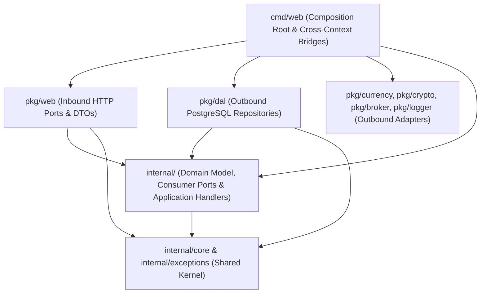

# Domain-Driven Design (DDD) Development Guidelines

This document is the authoritative engineering reference for **Strategic & Tactical Domain-Driven Design (DDD)**, **Clean / Hexagonal Architecture**, **Pragmatic CQRS**, **Secure-by-Design Persistence**, and **Test Architecture** in the Projecta backend (`internal/`, `pkg/`, `cmd/`). It consolidates Projecta's established architectural rules with idiomatic Go patterns and adapted code examples from *Go with the Domain* (Three Dots Labs).

---

## 1. Strategic DDD & Pragmatic Design Philosophy

### 1.1. Strategic Before Tactical (Pragmatism Over Dogma)
Architectural patterns exist to sustain **constant development velocity as the codebase ages**—not for "CV-Driven Development" or speculative complexity.
- **Strategic patterns come first**: Tactical patterns (encapsulation, value objects, repositories) deliver only a fraction of DDD's value if the team solves the wrong business problem or draws the wrong context boundaries.
- **Match complexity to the problem**: Apply full DDD, Clean Architecture, and CQRS where business invariants and workflows are genuinely non-trivial (`project`, `asset`, `investment`). Keep simple, data-oriented utilities or pure infrastructure glue straightforward—but stay alert to emerging complexity (a handful of "simple `if`s" in handlers is how unmaintainable multi-thousand-line methods begin).
- **Avoid Big Design Up Front (BDUF) and speculative "for the future" code**: You will never design the perfect model on day one. Instead of building unused abstractions upfront, keep clean layer boundaries and fast tests so the model can evolve cheaply and fearlessly.

### 1.2. Ubiquitous Language & Event Storming
- **Ubiquitous Language**: Product discussions, frontend models (`web-ui/src/models/`), backend types/methods (`internal/`), commands, and domain error messages must share the exact same business vocabulary—readable by non-technical stakeholders without translating technical jargon.
- **Design before coding non-trivial changes**: Before implementing a complex feature or boundary refactor, run a lightweight **Event Storming / Event Modeling** pass (10 minutes for a story, up to a session for a major capability):
  1. Map **Domain Events** (past-tense business facts, e.g., *Investment Allocated*, *Project Shared*, *Budget Updated*).
  2. Identify **Commands** (user/system intents that trigger them) and **Read Models** (UI views/charts).
  3. Locate **Aggregates & Policies** (the invariants that must hold atomically) and **Bounded Context** boundaries.
  - Changing a sticky note or design doc takes minutes; changing deployed schemas and contracts takes weeks.

### 1.3. Modularity & Bounded Context Autonomy
Projecta is structured as a **modular monolith** of autonomous bounded contexts under `internal/`:
- **`internal/project`**: Project lifecycle, ownership, participant sharing, and multi-currency tag budget schedules (`Project`, `TagBudget`, `Participant`, `Owner`).
- **`internal/asset`**: Project assets, hierarchical DAG compositions, cost rollups, valuations, and capital-investment forecasting (`Asset`, `AssetHierarchy`, `valuation.go`, `forecast.go`).
- **`internal/investment`**: Financial, time, and goods contributions allocated across project assets (`Investment`, `InvestmentAssetLink`).
- **`internal/people`**: Identity, authentication strategies, roles, and invitations (`Person`, `Credentials`, `DisplayName`, `Invitation`).
- **`internal/statement`**: Bank statement parsing and duplicate transaction detection (`StatementService`).
- **`internal/messages`**: Asynchronous message wire envelopes and topic contracts (`pkg/broker` bridge).

**Golden Rule of Context Isolation**:
> A bounded context package under `internal/` must **never** import another bounded context package. Cross-context collaboration happens exclusively through narrow, consumer-owned ports defined in the calling context and bridged by adapters in the composition root (`cmd/web/adapters.go`).

**Modularity Before Microservices**:
- Splitting a poorly decoupled codebase into microservices creates a **Distributed Monolith**—the same tight coupling plus network latency, distributed transactions (Sagas), and multi-repo deployment pain.
- Discover boundaries from **real transactional invariants and business responsibilities**, never by guessing `noun == entity` or mirroring database tables. If implementing one feature routinely forces changes across half the contexts, the boundary is wrong; if unrelated concerns pile into a single god-object, cohesion is missing.

### 1.4. When to Stay Away from DRY (Behavior vs. Data)
Blindly applying *Don't Repeat Yourself* across architectural layers is one of the fastest ways to create brittle coupling and accidental data leaks (for example, exposing an internal persistence field on an HTTP response when sharing one struct for DB and API).
- **Apply DRY to behaviors**: Centralize business rules, invariant validations, and domain calculations in one place.
- **Accept intentional duplication for data models across layers**: Keep separate structs for **Persistence Scan Records (`pkg/dal`)**, **Domain Aggregates (`internal/<context>`)**, **Query Read Models**, and **HTTP Transport DTOs (`pkg/web`)**.
- **Decision rule**: Ask *"Are these two consumers guaranteed to change together for the exact same reason?"* If not, duplicate the data structure so each layer can evolve independently.

```go
// BAD: Single struct shared between DB and HTTP forces ad-hoc scrubbing in handlers
// and risks leaking internal fields (e.g., PasswordHash, LastLoginIP) when extended.
type Person struct {
	ID           string `json:"id" db:"person_id"`
	DisplayName  string `json:"displayName" db:"display_name"`
	PasswordHash string `json:"passwordHash" db:"password_hash"` // accidental API leak!
	LastLoginIP  string `json:"lastLoginIp" db:"last_login_ip"`  // handler must remember to blank this
}

// GOOD: Separate structs per layer evolve independently with zero leak risk.
// pkg/dal/pg_people_repository.go (persistence model)
type personRecord struct {
	ID           uuid.UUID
	DisplayName  string
	PasswordHash string
	LastLoginIP  string
}

// pkg/web/dto.go (HTTP response DTO — exposes only public wire fields)
type PersonDTO struct {
	ID          string `json:"id"`
	DisplayName string `json:"displayName"`
}
```

---

## 2. Clean / Hexagonal Architecture & Layering

### 2.1. Shared Kernel Purity (`internal/core` & `internal/exceptions`)
- `internal/core` and `internal/exceptions` form the Shared Kernel and may be imported by any layer.
- **Zero Infrastructure or Transport Leaks**: `internal/core` and `internal/exceptions` must never import `database/sql`, `encoding/json`, `log`, or `pkg/*`, and must never contain `json:"..."` struct tags.
- **Strongly-Typed Aggregate Identifiers**: All aggregate roots use dedicated ID types defined in `internal/core/ids.go` (`core.PersonID`, `core.ProjectID`, `core.AssetID`, `core.InvestmentID`, `core.InvitationID`) rather than raw `uuid.UUID` or `string`.
- **Transport-Agnostic Errors with Machine-Readable Codes**: Domain and application layers return typed `exceptions.Exception` values carrying stable error codes (`VALIDATION_FAILED`, `UNAUTHORIZED`, `FORBIDDEN`, `NOT_FOUND`, `INTERNAL`)—never HTTP status codes or gRPC statuses. Translation to wire status codes happens solely in the inbound transport layer (`pkg/web`; see [contract-testing-guide.md](./contract-testing-guide.md)).

### 2.2. Ports, Adapters & Strict Dependency Inversion
To keep Hexagonal / Clean Architecture terminology unambiguous across the codebase:
- **Inbound Ports (Primary Adapters)**: Entry points driving the application (`pkg/web` HTTP handlers, CLI tools in `cmd/migrate`, async message consumers). They translate wire inputs into typed commands/queries and never touch persistence or outbound adapters directly.
- **Application Layer**: Thin use-case orchestrators (services / command & query handlers) inside `internal/<context>` that coordinate domain models and outbound interfaces without knowing which database, broker, or HTTP router backs them.
- **Domain Layer**: Pure business entities, value objects, invariants, and domain functions inside `internal/<context>`. Knows nothing about outer layers.
- **Consumer-Owned Interfaces (`ports.go`)**: Leveraging Go's implicit interfaces, outbound contracts are declared next to the code that consumes them (`internal/<context>/ports.go`), inverting dependencies so outer layers depend inward.
- **Outbound Adapters (Secondary Adapters)**: Concrete infrastructure implementations (`pkg/dal`, `pkg/currency`, `pkg/crypto`, `pkg/broker`, `cmd/web/adapters.go`) translating domain/application types to external protocols and storage.



| Layer | Location | Allowed Dependencies | Forbidden Dependencies |
| :--- | :--- | :--- | :--- |
| **Shared Kernel** | `internal/core`, `internal/exceptions` | Go stdlib (`context`, `errors`, `time`), `google/uuid` | `database/sql`, `encoding/json`, `log`, `pkg/*`, other `internal/*` |
| **Domain & App** | `internal/<context>` | `internal/core`, `internal/exceptions`, `go-money`, `google/uuid` | Other `internal/<context>`, `pkg/*`, `database/sql`, `encoding/json`, `log`, `net/http` |
| **Persistence (DAL)** | `pkg/dal` | `internal/<context>`, `internal/core`, `internal/exceptions`, `pgx`, `go-sqlbuilder` | `pkg/web`, `core.AuthGuard(ctx)` |
| **HTTP Transport** | `pkg/web` | Own context's `internal/<context>`, `internal/core`, `internal/exceptions`, `go-kit`, `mux` | Foreign `internal/<context>` for resource commands, `pkg/dal`, `pkg/currency` |
| **Composition Root** | `cmd/web` | All `internal/*` and `pkg/*` packages | — |

### 2.3. Fail-Fast Dependency Injection (`cmd/web`)
- All wiring happens explicitly in the composition root (`cmd/web/main.go`, `cmd/web/adapters.go`).
- Application service, handler, and adapter constructors must accept **explicit, compile-time checked interface types**—never untyped `...any` arguments with runtime type switches.
- Validate required dependencies in constructors and **fail fast at startup** (return an error or `panic("missing <dependency>")` during composition-root initialization) rather than allowing nil-pointer panics on the first production request:

```go
// internal/investment/service.go (or handler constructor)
func NewAllocateInvestmentHandler(
	repo InvestmentRepository,
	projectReader ProjectReader,
	assetReader AssetReader,
) AllocateInvestmentHandler {
	if repo == nil {
		panic("missing investment repository")
	}
	if projectReader == nil {
		panic("missing project reader")
	}
	if assetReader == nil {
		panic("missing asset reader")
	}
	return AllocateInvestmentHandler{
		repo:          repo,
		projectReader: projectReader,
		assetReader:   assetReader,
	}
}
```

---

## 3. Tactical Domain Modeling (DDD Lite & Aggregate Design)

### 3.1. The Three Rules of DDD Lite
1. **Reflect business logic literally**: Stop modeling structs as passive ORM data bags with generic getters and setters. Express domain concepts through behavior-oriented methods (`Allocate`, `LinkChild`, `TransitionStatus`, `Complete`, `SetTagBudgets`) that read directly like business rules.
2. **Always keep a valid state in memory**: Enforce invariants in a single authoritative place—domain constructors and behavior methods—so it is **impossible** for a caller (especially a newcomer without "shaman knowledge" of the codebase) to construct or mutate an entity into an invalid state.
3. **Keep the domain database- and transport-agnostic**: Domain types are shaped solely by business rules, never by SQL tables, ORM annotations, or JSON schemas.
   - **Domain-First workflow**: For complex features or refactors, design and unit-test the pure domain package first (optionally backed by a simple in-memory repository during exploration, timeboxed), deferring SQL schemas and HTTP endpoints until invariants are solid.

```go
// BAD: Anemic entity with setters leaks invariants into handlers/services.
// Any caller who forgets an `if` check puts the aggregate into an illegal state.
if asset.Status == AssetStatusPlanned && asset.TargetAmount > 0 {
	asset.SetStatus(AssetStatusCompleted)
}

// GOOD: Behavior-oriented method reflects Ubiquitous Language literally
// and guarantees the aggregate is always valid in memory.
func (a *Asset) Complete(completedAt time.Time) error {
	if a.status == AssetStatusCompleted {
		return exceptions.NewValidationException("asset is already completed", nil)
	}
	if completedAt.IsZero() {
		return exceptions.NewValidationException("completion time is required", nil)
	}
	a.status = AssetStatusCompleted
	a.completedAt = copyTimePtr(&completedAt)
	return nil
}
```

### 3.2. Encapsulation, Private State & Defensive Copying
- **Unexported Fields**: Every struct field on an Aggregate Root (`Project`, `Asset`, `Investment`, `Person`, `Invitation`) and Value Object (`TagBudget`, `Participant`, `DisplayName`, `Credentials`, `EmailAddress`, `InvitationCode`) must be unexported (private).
- **Read-Only Getters**: Expose state via getters (`ID()`, `Name()`, `Amount()`, `MainCurrency()`). Never expose raw setters that bypass invariant validation.
- **Defensive Copying for Slices, Maps & Pointers**: Aggregates must never leak internal mutable references through constructors, mutators, or getters:

```go
// Slice Getter: always return a copy
func (p *Project) TagBudgets() []TagBudget {
	if p.tagBudgets == nil {
		return make([]TagBudget, 0)
	}
	cp := make([]TagBudget, len(p.tagBudgets))
	copy(cp, p.tagBudgets)
	return cp
}

// Pointer Getter & Constructor Input: always copy pointer values
func copyOwner(o *Owner) *Owner {
	if o == nil {
		return nil
	}
	cp := *o
	return &cp
}

func (p *Project) Owner() *Owner {
	return copyOwner(p.owner)
}
```
Apply pointer defensive helpers (`copyTimePtr`, `copyFloat64Ptr`, `copyInt64Ptr`, `copyOwner`) both when accepting pointers into constructors/mutators and when returning them from getters.

### 3.3. Reference Other Aggregates by Identity Only
An aggregate must **never** hold a direct pointer to another aggregate root from a different context or lifecycle (e.g., `Investment` must never hold `*asset.Asset` or `*project.Project`).
- Reference related aggregates strictly by their strongly-typed ID (`core.ProjectID`, `core.AssetID`, `core.PersonID`) and immutable snapshot value objects (`OwnerRef`, `ContributorRef`, `InvestmentAssetLink`).

### 3.4. Creation Constructors vs. Persistence Reconstitution Factories
Separate domain creation from database hydration:
1. **Domain Creation Constructor (`New<Entity>` / `Create<Entity>`)**:
   - Enforces all business invariants (non-empty names, positive monetary amounts, valid currencies, valid date ordering, valid share percentages).
   - Generates defaults (e.g., new ID if nil, default `"UAH"` currency, share tokens).
   - Returns `(*Entity, error)` where validation failures return `exceptions.NewValidationException(...)`.
2. **Persistence Reconstitution Factory (`Reconstitute<Entity>`)**:
   - Hydrates an entity from trusted database records without re-running creation-only rules or generating new timestamps/tokens.
   - Defensively copies slice and pointer inputs.
   - Returns `*Entity` (or value object `TagBudget`) directly.
   - Never keep unvalidated legacy constructors in the domain.
3. **Test-Only `MustNew<Entity>` Helpers** *(optional)*:
   - For frequently constructed domain value objects/entities in tests, `MustNew*` helpers (which panic on invalid arguments) keep test setup concise without relaxing production error handling. Never call `MustNew*` on untrusted runtime inputs.

```go
// 1. Validating domain creation constructor (production code)
func NewParticipant(personID core.PersonID, displayName string) (Participant, error) {
	if personID.IsNil() {
		return Participant{}, exceptions.NewValidationException("missing participant person ID", nil)
	}
	name := strings.TrimSpace(displayName)
	if name == "" {
		return Participant{}, exceptions.NewValidationException("missing participant display name", nil)
	}
	return Participant{personID: personID, displayName: name}, nil
}

// 2. Test convenience constructor (never call on untrusted runtime inputs)
func MustNewParticipant(personID core.PersonID, displayName string) Participant {
	p, err := NewParticipant(personID, displayName)
	if err != nil {
		panic(err)
	}
	return p
}

// 3. Persistence reconstitution factory (called exclusively by pkg/dal)
func ReconstituteParticipant(personID core.PersonID, displayName string) Participant {
	return Participant{personID: personID, displayName: displayName}
}
```

### 3.5. Fail-Fast Mutation Invariants & Idiomatic Go Domain Functions
- **Fail fast**: All state transitions occur through expressive domain behavior methods (`UpdateDetails`, `UpdateValuation`, `Allocate`, `SetTagBudgets`, `SetDates`, `TransitionStatus`, `Complete`). Never silently ignore invalid arguments (e.g., do not skip negative amounts or empty names with a silent `return nil`); return `exceptions.NewValidationException(message, nil)`.
- **Behavior-oriented operations over CRUD god-methods**: Prefer small, intent-revealing domain methods and commands over one giant `UpdateEverything` method full of conditional branches.
- **Plain Go functions for stateless domain policies**: Do not invent Java-style stateless `DomainService` structs when a plain Go package function suffices. Pure business calculations or cross-entity policies (e.g., asset hierarchy rollups, capital-investment forecasts in `internal/asset/forecast.go`, authorization predicates) belong as clean package-level functions in `internal/<context>/`:

```go
// internal/project/access.go — stateless domain policy as a plain Go function,
// readable directly by non-technical stakeholders and trivial to unit-test.
func CanPersonViewProject(personID core.PersonID, p Project) error {
	if personID.IsNil() {
		return exceptions.NewUnauthorizedException("missing requester identity", nil)
	}
	if p.IsOwnedByPerson(personID) || p.HasParticipant(personID) {
		return nil
	}
	return exceptions.NewForbiddenException(
		fmt.Sprintf("person %s cannot access project %s", personID, p.ID()),
		nil,
	)
}
```

---

## 4. Ports, Cross-Context Isolation & Multi-Currency Valuation

### 4.1. Narrow Consumer-Owned Ports
When an application service or handler needs data or behavior from another bounded context or external infrastructure, define a **narrow interface in the consumer's `ports.go`** using the consumer's own types:

```go
// internal/investment/ports.go
type AssetDescriptor struct {
	ID   core.AssetID
	Name string
}

type AssetReader interface {
	FindAsset(ctx context.Context, projectID core.ProjectID, assetID core.AssetID) (AssetDescriptor, error)
}

type ProjectDescriptor struct {
	ID           core.ProjectID
	MainCurrency string
}

type ProjectReader interface {
	FindProject(ctx context.Context, projectID core.ProjectID) (ProjectDescriptor, error)
}
```
- **Small interfaces win**: Keep each port focused on the minimal methods needed by its consumer so unit-test mocks stay trivial (1–2 methods) and coupling stays minimal.

### 4.2. Composition-Root Bridge Adapters (`cmd/web/adapters.go`)
Cross-context adapters live exclusively in `cmd/web/adapters.go`:
- **No N+1 Loops**: Use batch filter criteria (e.g., `investment.CollectionFilter{ProjectID: projectID, IDs: ids}`) rather than looping over `FindOne`.
- **Full Pagination**: When aggregating across collections (e.g., `investmentTransactionFinder.FindExisting`, `projectTotalsCalculatorAdapter.CalculateTotals`), iterate through pages until all elements are retrieved rather than relying on a single hardcoded limit.
- **Propagate Errors**: Never silently swallow errors with `continue` inside adapter loops.
- **Sync vs. Async Discipline**: Synchronous cross-context calls work well for fast in-process lookups and strict consistency checks. When side effects are slow, failure-prone, or belong to an independent workflow (e.g., notifications, background indexing), decouple via asynchronous messaging (`internal/messages`, `pkg/broker`) instead of building brittle synchronous call chains.

### 4.3. Pure Domain Multi-Currency Valuation
- **Domain Port**: Each context that performs currency conversion (`internal/asset`, `internal/investment`, `internal/project`) defines a pure domain interface using `*money.Money`:
  ```go
  type CurrencyConverter interface {
      ConvertMoney(amount *money.Money, targetCurrency string) (*money.Money, error)
  }
  ```
- **Infrastructure Bridge**: `pkg/currency` remains agnostic of domain entities; `currencyConverterAdapter` in `cmd/web/adapters.go` bridges `CurrencyConverter` to `currency.CurrencyRateProvider`.
- **Dynamic Evaluation on Reads & Writes**:
  - Entities store their native `amount` and `currency` in persistence.
  - Home-currency equivalents (`HomeAmount()`, `TargetHomeAmount()`, `AnnualHomeTotal()`) are dynamically evaluated against the project's `MainCurrency()` using `CurrencyConverter` during both read (`Find`, `FindOne`) and write (`Create`, `Update`, `UpdateBudget`, `AcceptShare`) use cases:
    - `asset`: `anAsset.EvaluateValuation(homeCurrency, s.rateProvider)`
    - `investment`: `inv.EvaluateHomeAmount(s.rateProvider, proj.MainCurrency)`
    - `project`: `proj.EvaluateTagBudgets(s.converter)`

---

## 5. Application Layer & Pragmatic CQRS

### 5.1. Pragmatic CQRS (Command Query Responsibility Segregation)
CQRS does **not** require event sourcing, separate read databases, or heavy messaging infrastructure. Basic CQRS in Go is simply separating **write operations (Commands)** from **read operations (Queries)** so write invariants and UI read shapes can evolve independently.

- **Commands (Writes)**:
  - Mutate state through the rich Domain Model and enforce invariants.
  - Ideally return only `error` (or minimal identity/projection when an existing HTTP contract requires it).
  - **Pre-generated IDs for new resources**: When callers need the ID of a newly created resource, prefer generating the strongly-typed UUID (`core.NewProjectID()`, `core.NewAssetID()`, etc.) before executing the command and passing it inside the command struct. This keeps command signatures clean and works identically if a command later becomes asynchronous. For new REST endpoints, `201`/`204` with `Content-Location` (or calling the query after the command succeeds) keeps write handlers clean.
- **Queries (Reads)**:
  - Must never mutate domain state (logging/metrics excluded).
  - Both reads and writes may safely share the **same PostgreSQL database**.
  - For simple lookups, reusing the domain repository is completely fine. For UI-heavy views, dashboards, rollups, or forecasts that differ from aggregate structure, define dedicated **Read Model** structs and narrow query interfaces (e.g., `AvailableTagsReadModel`, `ForecastReadModel`) that query PostgreSQL directly without hydrating full write aggregates.
- **Splitting Wide Application Services**:
  - As a bounded context's monolithic `Service` grows wide (forcing unit tests to implement stub/unimplemented methods on giant mocks), split it into focused **Command Handlers** and **Query Handlers** (one file per use case, grouped under an `Application{Commands, Queries}` facade), injecting only the narrow ports each handler needs.
  - Newcomers can immediately understand a context's entire capability surface simply by scanning its command and query list.
- **Business-Oriented Naming**:
  - Prefer domain verbs (`AllocateInvestment`, `LinkChildAsset`, `AcceptProjectShare`, `UpdateProjectBudget`) over generic `Create`/`Update`/`Delete` whenever a stronger Ubiquitous Language term exists.
- **Uniform Cross-Cutting Concerns**:
  - Command and query handler boundaries are the single place for structured execution logging, timing, and metrics so every entry point (HTTP, CLI, message handler) behaves consistently.
- **When NOT to Use CQRS**:
  - Skip CQRS for authentication/token-exchange flows (which inherently validate input and return tokens) and tiny pure-CRUD modules where read and write models are identical.
- **Deferred Evolution Path**:
  - Clean command/query boundaries make it straightforward to adopt async command queues (`pkg/broker`), dedicated read projections, or Event Sourcing (for strict financial audit trails) later *only if real scale or audit requirements demand it*.

#### Example: CQRS Command Handler, Query Handler, and `Application` Facade

```go
// 1. Command + Handler: thin orchestration + uniform cross-cutting logging
type UpdateProjectBudget struct {
	ProjectID   core.ProjectID
	RequesterID core.PersonID
	TagBudgets  []TagBudgetInput
}

type UpdateProjectBudgetHandler struct {
	repo      ProjectRepository
	converter CurrencyConverter
	logger    core.Logger
}

func (h UpdateProjectBudgetHandler) Handle(ctx context.Context, cmd UpdateProjectBudget) (err error) {
	start := time.Now()
	defer func() {
		h.logger.LogCommand("UpdateProjectBudget", time.Since(start), err)
	}()

	return h.repo.UpdateProject(
		ctx,
		cmd.ProjectID,
		cmd.RequesterID,
		func(ctx context.Context, p *Project) (*Project, error) {
			if !p.IsOwnedByPerson(cmd.RequesterID) {
				return nil, exceptions.NewForbiddenException("only project owner can update budget", nil)
			}
			if err := p.SetTagBudgets(cmd.TagBudgets); err != nil {
				return nil, err
			}
			if err := p.EvaluateTagBudgets(h.converter); err != nil {
				return nil, err
			}
			return p, nil
		},
	)
}
```

```go
// 2. Query + UI-Optimized Read Model (same PostgreSQL DB, decoupled from write aggregate)
type ProjectSummaryReadModel interface {
	FindProjectSummaries(ctx context.Context, requesterID core.PersonID) ([]ProjectSummary, error)
}

type ProjectSummary struct {
	ID               core.ProjectID
	Name             string
	MainCurrency     string
	ParticipantCount int
	TotalInvested    int64
}

type ProjectSummariesQuery struct {
	RequesterID core.PersonID
}

type ProjectSummariesHandler struct {
	readModel ProjectSummaryReadModel
}

func (h ProjectSummariesHandler) Handle(ctx context.Context, q ProjectSummariesQuery) ([]ProjectSummary, error) {
	if q.RequesterID.IsNil() {
		return nil, exceptions.NewUnauthorizedException("missing requester identity", nil)
	}
	return h.readModel.FindProjectSummaries(ctx, q.RequesterID)
}
```

```go
// 3. Application Facade + Pre-Generated ID in HTTP Port (works for sync & async commands)
type Application struct {
	Commands Commands
	Queries  Queries
}

type Commands struct {
	CreateProject       CreateProjectHandler
	UpdateProjectBudget UpdateProjectBudgetHandler
	AcceptProjectShare  AcceptProjectShareHandler
}

type Queries struct {
	ProjectSummaries ProjectSummariesHandler
}

// pkg/web/project.go — thin inbound port pre-generates strongly-typed ID
func (h ProjectHTTPHandler) CreateProject(w http.ResponseWriter, r *http.Request) {
	requesterID, err := requesterIDFromRequest(r)
	if err != nil {
		writeErrorResponse(w, err)
		return
	}
	req, err := decodeCreateProjectDTO(r)
	if err != nil {
		writeErrorResponse(w, err)
		return
	}

	cmd := project.CreateProject{
		ProjectID:    core.NewProjectID(), // pre-generated before command execution
		RequesterID:  requesterID,
		Name:         req.Name,
		MainCurrency: req.MainCurrency,
	}
	if err := h.app.Commands.CreateProject.Handle(r.Context(), cmd); err != nil {
		writeErrorResponse(w, err)
		return
	}
	w.Header().Set("Content-Location", "/projects/"+cmd.ProjectID.String())
	w.WriteHeader(http.StatusNoContent)
}
```

### 5.2. Thin Orchestration & Explicit Command / Filter Structs
- All service mutations and queries accept dedicated value structs defined in `commands.go` and `filters.go` (`CreateProjectCommand`, `UpdateProjectBudgetCommand`, `CreateInvitationCommand`, `DeleteInvitationCommand`, `ProjectFilter`, `CollectionFilter`), using strongly-typed domain/core types (`core.ProjectID`, `core.PersonID`, value objects) rather than raw untyped strings to prevent argument-order bugs.
- **No Domain Logic in the Application Layer**: Application services and command handlers are strictly orchestrators (authorize -> load -> invoke domain methods -> call outbound ports -> persist). Whenever business `if`-trees or calculations start accumulating in an application handler, extract them into domain entity methods or pure domain functions.

### 5.3. Authorization, Tenant Isolation & Secure-by-Design Boundaries
Security should be **enforced by design**, not by hoping every developer remembers an `if` check in every handler.

1. **Domain Owns Authorization Rules**:
   - Business access policies ("who can view, edit, or delete a project or its resources?") belong in the **Domain Layer** (e.g., `p.IsOwnedByPerson(personID)`, `CanPersonViewProject(personID, p)`), making them reusable and unit-testable.
2. **Explicit Actor Passing Over Hidden `context.Context` Values**:
   - **Preferred rule for new and refactored use cases**: Extract authenticated identity (`RequesterID core.PersonID` and roles) at the **inbound port boundary (`pkg/web`)** and pass it **explicitly on typed Command, Query, and Filter structs** (as `internal/project/commands.go` already does with `PersonID core.PersonID`). Avoid hiding required application inputs inside `context.Context`, which defeats Go's static type checking and obscures function dependencies.
   - **Legacy boundary rule**: Where existing application services or composition-root adapters still call `core.AuthGuard(ctx)`, keep `AuthGuard` strictly at the application entry boundary—**never** inside domain entities or `pkg/dal`.
3. **Project Membership & Ownership Enforcement**:
   - Every project-scoped operation in `internal/asset` (`Create`, `Update`, `Remove`, `FindOne`, `Find`, `LinkChild`, `UnlinkChild`, `Group`) and `internal/investment` (`Create`, `CreateBatch`, `Update`, `Remove`, `FindOne`, `Find`, `FindTags`) must verify project access (`verifyProjectAccess` / `ProjectID` + `RequesterID` scoping) so users cannot read or mutate resources across projects they do not own or participate in.
   - Destructive or administrative project mutations (`ProjectServiceImpl.Update`, `UpdateBudget`, `Remove`) must verify `p.IsOwnedByPerson(personID)` and return `exceptions.NewForbiddenException` for non-owners.
   - Duplicate-name checks on creation (`ProjectServiceImpl.Create`) must scope `ProjectFilter` by `RequesterID: command.PersonID` to prevent cross-tenant leakage.
4. **Internal, Migration & System Operations (No "Fake Users")**:
   - Never fabricate fake/impersonated `PersonID`s or boolean bypass flags (`skipAuth: true`) for background jobs, migrations, or message consumers—they breed `if`-spaghetti and corrupt audit trails.
   - Instead, define an explicit system role with documented permissions or expose **distinct, explicitly named repository methods / actor-specific commands** so the security boundary is unmistakable in code review:

```go
// internal/project/ports.go — explicit security boundary in method signatures
type ProjectRepository interface {
	// Standard user-facing methods ALWAYS require requesterID so unauthorized access is impossible by design.
	GetProject(ctx context.Context, projectID core.ProjectID, requesterID core.PersonID) (*Project, error)
	UpdateProject(
		ctx context.Context,
		projectID core.ProjectID,
		requesterID core.PersonID,
		updateFn func(ctx context.Context, p *Project) (*Project, error),
	) error

	// Unscoped internal/migration methods are explicitly named to flag security implications in code review.
	FindAllUnscopedForMigration(ctx context.Context) ([]*Project, error)
}
```

### 5.4. Transactional Boundaries & Concurrency Control
1. **Multi-Aggregate / Multi-Statement Unit of Work (`db.Tx`)**:
   - Any use case that mutates multiple aggregates or executes multiple SQL statements (`asset.CreateFromInvestments`, `asset.LinkChildren`, `asset.Remove`, `investment.Create`, `investment.Update`, `investment.AssignToAsset`, `investment.Remove`, `project.Create`, `project.Update`) must execute inside `db.Tx(ctx, func(txCtx context.Context) (any, error) { ... })`.
   - `PgDbConnection.Tx` automatically reuses an active transaction present in `ctx`, making nested transactional service calls safe and atomic.
2. **Single-Aggregate Read-Modify-Write Concurrency Safety (Repository Update-Closure Pattern)**:
   - Plain `FindOne` followed by `Save` without locking is vulnerable to lost updates under concurrent requests.
   - For aggregates subject to concurrent mutations (e.g., concurrent allocations, status transitions, or budget edits), prefer the **Repository Update-Closure pattern** (shown in Section 6.2) with `SELECT ... FOR UPDATE` (pessimistic row locking) or a version column (optimistic locking).

### 5.5. Preserving Domain Exception Semantics
Application services must never wrap domain `ValidationException`, `UnauthorizedException`, `ForbiddenException`, or `NotFoundException` errors inside `exceptions.NewInternalException` (which would turn HTTP `400`/`401`/`403`/`404` responses into `500 Internal Server Error`):

```go
func preserveOrWrapError(err error, fallbackMsg string) error {
	if err == nil {
		return nil
	}
	var exc exceptions.Exception
	if errors.As(err, &exc) {
		return err
	}
	if errors.Is(err, exceptions.NotFoundError) {
		return exceptions.NewNotFoundException(fallbackMsg, err)
	}
	return exceptions.NewInternalException(fallbackMsg, err)
}
```

---

## 6. Persistence Layer (`pkg/dal`) Guidelines

### 6.1. Intermediate Scan Records & Two-Phase Hydration
Repositories in `pkg/dal` must never attach `db:`/`json:` tags to domain structs, instantiate dummy domain aggregates during SQL scanning, or mutate aggregates post-hoc after scanning:
1. Scan database rows into private intermediate transport structs (`projectRecord`, `investmentRecord`, `personRecord`, `invitationRecord`).
2. Close the primary cursor (`rows.Close()`) before running auxiliary queries (e.g., `fetchParticipants`, `fetchTagBudgets`, `loadAllocations`).
3. Hydrate the aggregate in a single shot via `Reconstitute<Entity>(...)`.

### 6.2. Atomic Idempotent Upserts, Update Closures & Safe Transaction Finalization
- **Atomic Upserts**: Avoid the `FindOne`-before-`Save` anti-pattern. Persistence `Save` methods (`PgAssetRepository.Save`, `PgInvestmentRepository.Save`, `PgPeopleRepository.Save`, `PgInvitationRepository.Save`, `PgProjectRepository.saveTagBudgets`) must use atomic PostgreSQL `INSERT INTO ... ON CONFLICT (...) DO UPDATE SET ...` statements, reading aggregate state exclusively via domain getters.
- **Transactional Update Closure + `FOR UPDATE` + Safe `defer` Finalization**: When a repository manages an atomic read-modify-write transaction directly, lock the row with `SELECT ... FOR UPDATE`, verify domain access rules before calling `updateFn`, persist the returned aggregate, and finalize via a `defer` using a named `(err error)` return so neither rollback nor commit errors are ever silently lost:

```go
// pkg/dal/pg_project_repository.go
func (r *PgProjectRepository) UpdateProject(
	ctx context.Context,
	projectID core.ProjectID,
	requesterID core.PersonID,
	updateFn func(ctx context.Context, p *project.Project) (*project.Project, error),
) (err error) {
	tx, err := r.pool.Begin(ctx)
	if err != nil {
		return fmt.Errorf("begin tx: %w", err)
	}
	defer func() {
		err = finishTransaction(ctx, tx, err)
	}()

	// Lock the aggregate row inside the transaction to prevent concurrent lost updates.
	existing, err := r.findOneLocked(ctx, tx, projectID) // executes SELECT ... FOR UPDATE
	if err != nil {
		return err
	}

	// Secure by design: enforce domain visibility/access before exposing aggregate to updateFn.
	if err := project.CanPersonViewProject(requesterID, *existing); err != nil {
		return err
	}

	updated, err := updateFn(ctx, existing)
	if err != nil {
		return err
	}

	return r.upsertProject(ctx, tx, updated)
}

func finishTransaction(ctx context.Context, tx pgx.Tx, err error) error {
	if err != nil {
		if rollbackErr := tx.Rollback(ctx); rollbackErr != nil {
			return errors.Join(err, rollbackErr)
		}
		return err
	}
	if commitErr := tx.Commit(ctx); commitErr != nil {
		return fmt.Errorf("failed to commit tx: %w", commitErr)
	}
	return nil
}
```

### 6.3. Repository Secure by Design, Explicit Filters & In-Memory Value Semantics
- **Zero `AuthGuard` in DAL**: Repositories apply `WHERE` clauses strictly based on explicit typed arguments or fields present on the `Filter` struct (`filter.RequesterID`, `filter.OwnerID`, `filter.ProjectID`, `filter.IDs`).
- **Make Unauthorized Reads/Writes Structurally Impossible**:
  - For single-aggregate reads and updates, require `requesterID` in the repository signature/filter and verify domain access rules before returning or updating the aggregate (see `UpdateProject` above).
  - For **collections**, push authorization filtering directly into SQL rather than loading all rows and filtering in Go—a small, well-tested query predicate duplication is far better than scanning unbounded tables:
    ```sql
    (owner_id = $1 OR project_id IN (SELECT project_id FROM projecta_project_shares WHERE person_id = $1))
    ```
- **Sentinel `NotFoundError` Wrapping**: Repository not-found errors (`ErrAssetNotFound`, `ErrInvestmentNotFound`) must wrap `exceptions.NotFoundError` (`errors.Join(exceptions.NotFoundError, ...)`) so `errors.Is(err, exceptions.NotFoundError)` succeeds across layers.
- **Whitelist `OrderBy` Columns & Deterministic Tie-Breakers**: Always validate `filter.OrderBy` against an explicit whitelist map before passing column names to `sqlbuilder`, and include a stable unique tie-breaker column (e.g., `investment_id`, `asset_id`) for deterministic pagination.
- **In-Memory Repositories Store Values, Not Pointers**: Any in-memory repository (used for Domain-First exploration or fast tests) must store **value copies** (and protect map access with `sync.RWMutex`), never pointers to live aggregates, so mutations inside a rolled-back update closure cannot silently corrupt stored state:

```go
// In-memory repository for Domain-First exploration & tests:
// stores project.Project values (not *project.Project) so failed updateFn never leaks state.
type MemoryProjectRepository struct {
	mu       sync.RWMutex
	projects map[core.ProjectID]project.Project
}

func (m *MemoryProjectRepository) UpdateProject(
	ctx context.Context,
	projectID core.ProjectID,
	requesterID core.PersonID,
	updateFn func(ctx context.Context, p *project.Project) (*project.Project, error),
) error {
	m.mu.Lock()
	defer m.mu.Unlock()

	existing, ok := m.projects[projectID]
	if !ok {
		return exceptions.NewNotFoundException("project not found", nil)
	}
	if err := project.CanPersonViewProject(requesterID, existing); err != nil {
		return err
	}

	// Pass pointer to local copy; map entry is only replaced if updateFn succeeds.
	candidate := existing
	updated, err := updateFn(ctx, &candidate)
	if err != nil {
		return err
	}
	m.projects[projectID] = *updated
	return nil
}
```

---

## 7. Transport Layer (`pkg/web`) Guidelines

### 7.1. Transport-Agnostic Domain & Dedicated DTOs
- Domain aggregates, value objects, and shared kernel types (`Participant`, `DisplayName`, `StatementParseResult`, `AuthResponse`, `Exception`) must **never** implement `json.Marshaler` / `json.Unmarshaler` or carry `json:"..."` tags.
- Define dedicated request/response DTO structs (`ProjectDTO`, `TagBudgetDTO`, `AssetDTO`, `InvestmentDTO`, `AuthResponseDTO`, `StatementParseResultDTO`, `errorResponseDTO`) and mapper functions (`toProjectDTO`, `toTagBudgetInputs`, `toAuthResponseDTO`) inside `pkg/web`.
- Keep HTTP routing and middleware lightweight and `net/http`-compatible; avoid heavy full-stack web frameworks that couple handlers to framework internals.

### 7.2. Thin Decoders, Pointer Semantics & Contract Discipline
- HTTP decoders (`decodeCreateAssetRequest`, `decodeUpdateProjectBudgetRequest`, etc.) are responsible strictly for parsing URL parameters, auth headers/context identity, and JSON wire bodies into typed application Command/Query structs—never business validation.
- Use pointer fields on DTOs (e.g., `SharePercentage *float64`, `TagBudgets *[]TagBudgetDTO`) when distinguishing between an omitted JSON field (apply default) and an explicit zero/negative value (pass through to domain validation).
- Each transport file (`pkg/web/assets.go`, `pkg/web/investments.go`, `pkg/web/project.go`) must decode into its own bounded context's Command types without importing foreign domain packages.
- Remember: strong wire contracts (OpenAPI / DTOs / contract tests) prevent schema drift, but **do not guarantee semantic data validity**—domain constructors and mutators remain the source of truth for invariants.

---

## 8. Test Architecture & Verification Strategy

High-quality tests are first-class engineering assets designed with the same rigor as production code.

### 8.1. Four Principles of High-Quality Tests
1. **Fast**: Local unit and repository suites should finish in seconds (target `<10s`, never minutes). Slow suites trigger context-switching and discourage frequent runs.
2. **Pragmatic Multi-Level Coverage**: Aim for high coverage in pure domain logic and ~70–80% overall—**not** dogmatic 100%. Ask *"how easily can this break?"* Skip trivial pass-through glue tests that merely mirror implementation and test mocks.
   - Use the classic **Test Pyramid** (many unit tests, fewer integration/component, thin E2E) for domain-heavy write contexts (`project`, `asset`, `investment`).
   - Use an **Inverted Pyramid ("Christmas Tree")** (heavier integration/query tests) for data-aggregation or SQL-heavy read modules with little pure domain logic.
3. **Deterministic & Zero Flakiness**: Never use `time.Sleep` or CI retry loops to mask race conditions. Synchronize goroutines with channels and `sync.WaitGroup`, or poll conditions with bounded `Eventually` helpers. Treat flaky tests as broken windows and fix them immediately.
4. **Locally Executable**: Developers must be able to run unit, integration, and component tests locally via Docker (`docker compose`) before pushing—E2E in CI is a final contract double-check, not the primary test harness.

### 8.2. Test Taxonomy Matrix

| Test Type | Real Postgres (Docker) | External Systems (NBU, Google, AMQP) | Focus | Mocks Used | Tested Surface | Projecta Location |
| :--- | :---: | :---: | :--- | :--- | :--- | :--- |
| **Unit** | No | No | Domain invariants, edge cases, non-trivial app orchestration | Narrow port interfaces (hand-written) | Exported Go package API | `internal/<context>/*_test.go`, `web-ui/src/models/*.test.js` |
| **Integration** | Yes | No | SQL queries, migrations, transactions, rollbacks, row locks / races | None for DB | Repository methods | `pkg/dal/*_test.go` |
| **Component** | Yes | No | Full single-service flow (HTTP -> App -> Domain -> DB) happy paths & contracts | External third-party adapters only | HTTP endpoints (`pkg/web` + `cmd/web`) | `cmd/web/*_test.go`, `pkg/web/*_test.go` |
| **End-to-End (E2E)** | Yes | Yes (full stack) | Thin critical user journeys & cross-layer contracts | None | Running `docker compose` stack | See [contract-testing-guide.md](./contract-testing-guide.md) |

### 8.3. Unit Testing Rules (Domain & Application)
- **Prefer black-box tests (`package <name>_test`)**: Testing only exported constructors, methods, and getters proves the public API is ergonomic and prevents tests from breaking during internal refactors.
- **Table-driven tests**: Cover creation invariants, boundary values, failure cases, multi-currency valuation, and defensive-copy immutability (mutating returned slices/pointers must not mutate the aggregate).
- **Test readability & helpers**:
  - Mark shared setup/assertion helpers with `t.Helper()`.
  - Use fail-fast assertions (`require` / `t.Fatalf`) for preconditions and unexpected errors, and non-fatal assertions (`assert` / `t.Errorf`) when checking multiple fields for richer failure context.
  - When comparing encapsulated aggregates with unexported fields, write custom assertion helpers (e.g., using `github.com/google/go-cmp/cmp` with `cmp.AllowUnexported(...)`) rather than adding test-only getters to domain types.
- **Hand-written narrow mocks**: Because consumer ports in `ports.go` are narrow, write tiny struct mocks in test files rather than complex mocking frameworks—and never write tests that merely verify your mock returns what you configured it to return.

```go
// internal/project/project_test.go — black-box unit test with custom cmp helper
package project_test

func assertProjectsEqual(t *testing.T, expected, actual *project.Project) {
	t.Helper()
	opts := []cmp.Option{
		cmp.AllowUnexported(
			project.Project{},
			project.Owner{},
			project.Participant{},
			project.TagBudget{},
		),
	}
	if diff := cmp.Diff(expected, actual, opts...); diff != "" {
		t.Errorf("project mismatch (-want +got):\n%s", diff)
	}
}

func TestValidateCurrency(t *testing.T) {
	testCases := []struct {
		name      string
		input     string
		want      string
		wantError bool
	}{
		{name: "defaults_empty_to_UAH", input: "", want: "UAH"},
		{name: "normalizes_lowercase", input: " usd ", want: "USD"},
		{name: "rejects_unsupported", input: "BTC", wantError: true},
	}

	for _, tc := range testCases {
		t.Run(tc.name, func(t *testing.T) {
			got, err := project.ValidateCurrency(tc.input)
			if tc.wantError {
				if err == nil {
					t.Fatalf("expected error for %q, got nil", tc.input)
				}
				return
			}
			if err != nil {
				t.Fatalf("unexpected error: %v", err)
			}
			if got != tc.want {
				t.Errorf("got %q, want %q", got, tc.want)
			}
		})
	}
}
```

```go
// Tiny hand-written mock for a narrow consumer port (zero mocking framework needed)
type projectReaderStub struct {
	descriptor investment.ProjectDescriptor
	err        error
}

func (s projectReaderStub) FindProject(_ context.Context, _ core.ProjectID) (investment.ProjectDescriptor, error) {
	return s.descriptor, s.err
}
```

### 8.4. Database Integration Testing Rules (`pkg/dal`)
- **Test our usage of PostgreSQL, not PostgreSQL itself**: Verify schema mapping, two-phase `Reconstitute<Entity>` round-trips, `ON CONFLICT` idempotency, shared-project tenant predicates, `OrderBy` whitelists, and `NotFoundError` wrapping against a real PostgreSQL Docker container pinned to the production major version.
- **Explicitly test transaction rollbacks**: Trigger an error mid-transaction / inside an update closure and assert the persisted row remains unchanged.
- **Explicitly test concurrency & race conditions**: For locked updates or uniqueness invariants, spawn parallel goroutines (`workers := 20`) synchronized behind a single `close(startWorkers)` channel barrier and `sync.WaitGroup`, asserting that exactly one conflicting mutation succeeds or final state is consistent.
- **Use "Test Sabotage" when adding tests after implementation**: Temporarily break your rollback or `FOR UPDATE` clause to verify the integration test actually fails.
- **Parallel-safe & Cleanup-free by design**:
  - Run integration tests with `t.Parallel()`.
  - Isolate each test with freshly generated unique IDs (`core.NewPersonID()`, `core.NewProjectID()`, unique emails/tags) so tests never collide and require no brittle global `TRUNCATE` cleanup.
  - Never assert global table counts (`len(all) == 1`); assert presence/absence of your test's specific IDs or scope queries by your test's unique tenant/project ID.
  - Keep genuinely sequential tests (e.g., global pagination checks) minimal and fast.

```go
// pkg/dal/pg_project_repository_integration_test.go — rollback & concurrency verification
package dal_test

func TestPgProjectRepository_UpdateProject_Rollback(t *testing.T) {
	t.Parallel()
	ctx := context.Background()
	repo := newTestProjectRepository(t)

	ownerID := core.NewPersonID() // unique per test => parallel-safe, no global cleanup
	proj := seedTestProject(t, ctx, repo, ownerID, "Initial Name")

	err := repo.UpdateProject(ctx, proj.ID(), ownerID, func(_ context.Context, p *project.Project) (*project.Project, error) {
		if err := p.UpdateDetails("Mutated Before Error", p.Description(), p.MainCurrency()); err != nil {
			return nil, err
		}
		return p, errors.New("simulated downstream failure")
	})
	if err == nil {
		t.Fatal("expected rollback error, got nil")
	}

	persisted, err := repo.GetProject(ctx, proj.ID(), ownerID)
	if err != nil {
		t.Fatalf("failed to reload project: %v", err)
	}
	if persisted.Name() != "Initial Name" {
		t.Fatalf("expected rollback to preserve %q, got %q", "Initial Name", persisted.Name())
	}
}

func TestPgAssetRepository_Complete_ParallelRace(t *testing.T) {
	t.Parallel()
	ctx := context.Background()
	repo := newTestAssetRepository(t)

	ownerID := core.NewPersonID()
	assetID := seedPlannedAsset(t, ctx, repo, ownerID)

	const workers = 20
	var wg sync.WaitGroup
	wg.Add(workers)

	// Closing startWorkers releases all goroutines simultaneously to maximize lock contention.
	startWorkers := make(chan struct{})
	succeeded := make(chan int, workers)

	for i := range workers {
		workerID := i
		go func() {
			defer wg.Done()
			<-startWorkers
			err := repo.UpdateAsset(ctx, assetID, ownerID, func(_ context.Context, a *asset.Asset) (*asset.Asset, error) {
				if err := a.Complete(time.Now().UTC()); err != nil {
					return nil, err
				}
				return a, nil
			})
			if err == nil {
				succeeded <- workerID
			}
		}()
	}

	close(startWorkers)
	wg.Wait()
	close(succeeded)

	var winners []int
	for w := range succeeded {
		winners = append(winners, w)
	}
	if len(winners) != 1 {
		t.Fatalf("expected exactly 1 worker to complete asset under FOR UPDATE lock, got %d", len(winners))
	}
}
```

### 8.5. Component & End-to-End Testing Rules
- **Component tests**: Wire the real HTTP router, handlers, application layer, domain, and PostgreSQL, replacing only external third-party dependencies (e.g., NBU rate provider, Google OAuth verifier, RabbitMQ broker) via composition-root test constructors (`NewComponentTestApplication`-style helpers).
  - Start the test server once per package in `TestMain` (or `httptest.NewServer`) and wait for readiness via port/health polling (`waitForPort`), **never** `time.Sleep`.
  - Wrap HTTP calls in readable, domain-named test client helpers so tests read like acceptance specifications, focusing on happy paths and HTTP/JSON contract integrity (leaving exhaustive edge cases to unit tests).
- **End-to-End tests**: Keep E2E scenarios short and few—covering critical end-to-end journeys against the real `docker compose` stack to confirm wiring and contracts haven't drifted.

```go
// cmd/web/component_test.go — real HTTP + Domain + Postgres, mocked external NBU provider
func NewComponentTestApp(ctx context.Context, db *dal.PgDbConnection) http.Handler {
	fixedRates := &staticCurrencyProviderStub{rates: map[string]float64{"USD": 40.0, "EUR": 44.0}}
	return buildHTTPHandler(ctx, db, fixedRates, &noopBrokerStub{})
}

func waitForPort(addr string, timeout time.Duration) bool {
	deadline := time.Now().Add(timeout)
	for time.Now().Before(deadline) {
		conn, err := net.DialTimeout("tcp", addr, 100*time.Millisecond)
		if err == nil {
			_ = conn.Close()
			return true
		}
		time.Sleep(25 * time.Millisecond) // bounded readiness polling only; never blind sleep in test assertions
	}
	return false
}

// Readable test client wrapper keeps component tests focused on business flows:
func (c *ProjectaTestClient) CreateProject(t *testing.T, name, currency string) core.ProjectID {
	t.Helper()
	resp := c.doJSON(t, http.MethodPost, "/projects", map[string]any{
		"name": name, "mainCurrency": currency,
	})
	if resp.StatusCode != http.StatusCreated && resp.StatusCode != http.StatusNoContent {
		t.Fatalf("unexpected status %d creating project %q", resp.StatusCode, name)
	}
	return parseCreatedProjectID(t, resp)
}
```

### 8.6. CI/CD & Local Environment Parity
- Maintain one base `docker-compose.yml` (with optional CI override files and explicit env profiles) so local and CI test runs exercise the same database version and configuration.
- Always run Go tests with **`-race -count=1`** in verification and CI: `-race` catches shared-memory bugs, and `-count=1` disables Go's test cache so infrastructure/Docker/env changes never produce stale cached passes.

---

## 9. Standard Workflow for New Features & Incremental Refactorings

When introducing a new domain concept or refactoring an existing one, follow this **Domain-First** sequence:

0. **Step 0 — Strategic Alignment (Non-Trivial Changes)**:
   - Align on Ubiquitous Language, Domain Events, Commands, Read Models, and Bounded Context boundaries before writing code. Confirm whether the feature belongs in an existing aggregate, a new aggregate, or a read model.
1. **Step 1 — Model the Pure Domain (`internal/<context>/<entity>.go`)**:
   - Define unexported struct fields, strongly-typed `core.*ID`, value objects, `New<Entity>` validating constructor, `Reconstitute<Entity>` persistence factory, fail-fast behavior methods, pure domain functions, and defensive-copy getters.
2. **Step 2 — Write Black-Box Domain Unit Tests (`internal/<context>/<entity>_test.go`)**:
   - Use table-driven tests to verify creation validation, invariant violations, state transitions, domain authorization predicates, multi-currency evaluation, and defensive-copy immutability.
3. **Step 3 — Define Narrow Ports & Application Layer (`internal/<context>/ports.go`, `commands.go`, `service.go` / handlers)**:
   - Declare minimal consumer-owned ports; implement thin use-case orchestration (or dedicated Command/Query handlers) with explicit actor/tenant checks, `db.Tx` / update-closure atomicity, and `preserveOrWrapError`.
4. **Step 4 — Implement Persistence Adapter & Integration Tests (`pkg/dal/pg_<entity>_repository.go`, `migrations/`)**:
   - Add SQL migration under `migrations/`, scan into private `<entity>Record` structs, enforce explicit tenant filters, use atomic `ON CONFLICT` upserts (and `FOR UPDATE` where concurrency applies), hydrate via `Reconstitute<Entity>`, and verify with parallel-safe DB integration tests (including rollback/concurrency cases).
5. **Step 5 — Wire Transport DTOs & Composition Root (`pkg/web/<entity>.go`, `cmd/web/adapters.go`, `cmd/web/main.go`)**:
   - Map between HTTP DTOs and domain Commands/Queries in `pkg/web`; wire cross-context and infrastructure adapters with fail-fast startup checks in `cmd/web`; add component/contract test coverage as needed.
6. **Step 6 — Run Master Verification & Update Knowledge Graph**:
   - Execute all automated checks in Section 11 and run `graphify update .`.

**Incremental Refactoring Discipline**:
- Timebox structural refactors and deliver them in small, reviewable vertical slices merged continuously—never let a massive refactoring branch drift for weeks.
- For high-impact boundary or aggregate refactors, prefer pair/mob alignment upfront so decisions are agreed on immediately rather than litigated in an unreviewable PR.

---

## 10. Anti-Patterns Reference Table

| Anti-Pattern | Problem | Standard Projecta Solution |
| :--- | :--- | :--- |
| **Misapplied DRY Across Layers** | Sharing one struct for DB, Domain, and HTTP leaks internal fields and couples unrelated changes | Duplicate data models intentionally (`<entity>Record` -> Domain Aggregate -> Read Model -> HTTP DTO); apply DRY to behaviors only. |
| **Cross-Context Imports in `internal/`** | Tight coupling between bounded contexts; blocks independent evolution | Define consumer-owned ports (`ProjectReader`, `AssetReader`, `OwnerReader`) in `ports.go` and bridge in `cmd/web/adapters.go`. |
| **Distributed Monolith / Premature Microservices** | Network overhead + distributed transactions without decoupling | Fix bounded-context boundaries inside the modular monolith first; split deployment units only when organizational/scaling needs justify it. |
| **Domain Importing `pkg/currency` or Infra** | Violates Dependency Inversion Principle; couples rules to providers | Define `CurrencyConverter` (`ConvertMoney(*money.Money, string)`) in the domain; adapt `NBUCurrencyRateProvider` in `cmd/web`. |
| **Cross-Aggregate Pointers** | `Investment` holding `*asset.Asset` blurs transactional boundaries | Reference by `core.AssetID` and read-only value snapshots (`InvestmentAssetLink`). |
| **Mutable Public Fields / Leaky Getters / ORM Setters** | External code mutates state bypassing business invariants | Unexport all fields; expose behavior methods; return defensive copies from all slice, map, and pointer getters. |
| **CRUD God-Methods & Silent Validation Failures** | Giant `Update` methods full of `if`s; invalid inputs silently ignored | Split into behavior-oriented commands/methods; return `exceptions.NewValidationException(...)` on any invariant violation. |
| **Business Logic in Application Services or Decoders** | Rules scatter outside domain; hard to unit-test and reuse | Keep decoders strictly for wire parsing and services for orchestration; move rules to domain methods or pure domain functions. |
| **JSON or DB Struct Tags in Domain** | Couples domain entities to HTTP wire format or SQL columns | Strip `encoding/json`, `json:"..."`, and `db:"..."` from `internal/`; map via DTOs in `pkg/web` and scan records in `pkg/dal`. |
| **Hidden Required Inputs in `context.Context` / `AuthGuard` in DAL** | Loses Go static type safety; couples SQL repos to HTTP request context | Extract identity at the inbound port (`pkg/web`) and pass `RequesterID` explicitly on Commands/Queries/Filters; never call `AuthGuard` in `pkg/dal`. |
| **"Fake Users" or `skipAuth` Hacks for Internal Jobs** | Breeds `if`-spaghetti, security holes, and broken audit trails | Define explicit system roles or dedicated, clearly named repository/command methods (e.g., `FindAllUnscopedForMigration`). |
| **Fake Stub Hydration in DAL** | Constructing dummy aggregates during SQL scans | Scan into intermediate `<entity>Record` structs and call `Reconstitute<Entity>`. |
| **`FindOne`-Before-`Save` / Unlocked Read-Modify-Write** | Extra queries and lost-update race conditions under concurrency | Use PostgreSQL `INSERT ... ON CONFLICT (...) DO UPDATE` upserts, and `Update<Entity>` closures with `SELECT ... FOR UPDATE` for concurrent writes. |
| **Unwrapped Multi-Table Writes** | Partial database state on mid-operation failure | Wrap multi-statement / multi-aggregate writes in `s.db.Tx(ctx, ...)`. |
| **Wrapping Domain Errors in `InternalException`** | Turns `400 Bad Request` / `404 Not Found` into `500 Internal Error` | Use `preserveOrWrapError` to pass `exceptions.Exception` through untouched. |
| **Untyped `...any` Service Constructors** | Bypasses compile-time type safety | Use typed interface parameters or typed builder methods (`.WithConverter(conv)`), failing fast on `nil` dependencies. |
| **`time.Sleep`, Global Cleanup, or Mock-Mirroring Tests** | Slow, flaky CI pipelines and brittle tests that catch zero bugs | Use `t.Parallel()` with unique per-test IDs, channel/`WaitGroup` sync, `Eventually` polling, real DB rollback/race tests, and `-race -count=1`. |
| **BDUF / Speculative "For the Future" Code** | Over-engineered abstractions solving imaginary problems | Build the minimal clean model for today's invariants; rely on decoupling and fast tests to add future capabilities cleanly. |

---

## 11. Master Verification & Code Review Checklist

Run the following verification suite before completing any backend or full-stack task:

```bash
# 1. Verify zero cross-context imports across all bounded contexts in internal/:
go list -f '{{.ImportPath}} -> {{.Imports}}' ./internal/...

# 2. Verify zero infrastructure/transport leaks (pkg/currency, database/sql, encoding/json, log) in domain and app packages:
! go list -f '{{.ImportPath}} -> {{.Imports}}' ./internal/asset ./internal/asset/app ./internal/investment ./internal/investment/app ./internal/project ./internal/project/app ./internal/people ./internal/statement ./internal/core ./internal/exceptions | grep -E "pkg/currency|database/sql|encoding/json|\blog\b"

# 3. Verify zero JSON struct tags in domain/core/exception packages (excluding internal/messages wire envelope):
! grep -rn 'json:"' internal/asset/ internal/investment/ internal/project/ internal/people/ internal/statement/ internal/core/ internal/exceptions/

# 4. Verify zero calls to core.AuthGuard outside pkg/web and internal/core:
! grep -rn "AuthGuard" internal/asset/ internal/investment/ internal/project/ internal/people/ internal/statement/ pkg/dal/ cmd/web/adapters.go

# 5. Verify zero references to pkg/currency in pkg/web:
! go list -f '{{.Imports}}' ./pkg/web | grep "pkg/currency"

# 6. Run all backend unit, DAL, web, and composition-root tests with race detector and no cache:
make test-unit

# 6b. Run real PostgreSQL integration & HTTP component tests (requires Docker):
# make test-integration

# 7. Run frontend domain & UI tests + production build:
node --test web-ui/src/models/*.test.js web-ui/src/components/Projects/ListView/ListView.content.test.js
npm --prefix web-ui run build

# 8. Update the codebase knowledge graph (after structural code changes):
graphify update .
```

### Code Review Quick-Check Questions
- **Strategic**: Does the code use Ubiquitous Language that a stakeholder could read without translation? Are boundaries aligned with real invariants?
- **Encapsulation**: Can any external caller put an aggregate into an invalid state or mutate internal slices/pointers?
- **DRY vs. Coupling**: Are DB records, domain entities, query read models, and HTTP DTOs kept separate so each layer can evolve independently?
- **Security by Design**: Is authorization enforced structurally via domain predicates and explicit tenant/actor parameters—never via hidden `context.Context` values in DAL or fake-user hacks?
- **Transactions & Concurrency**: Are multi-write flows wrapped in `db.Tx` and concurrent single-aggregate writes protected against lost updates?
- **Tests**: Are tests fast, deterministic (zero `time.Sleep`), parallel-safe, and written at the right layer of the test taxonomy?
